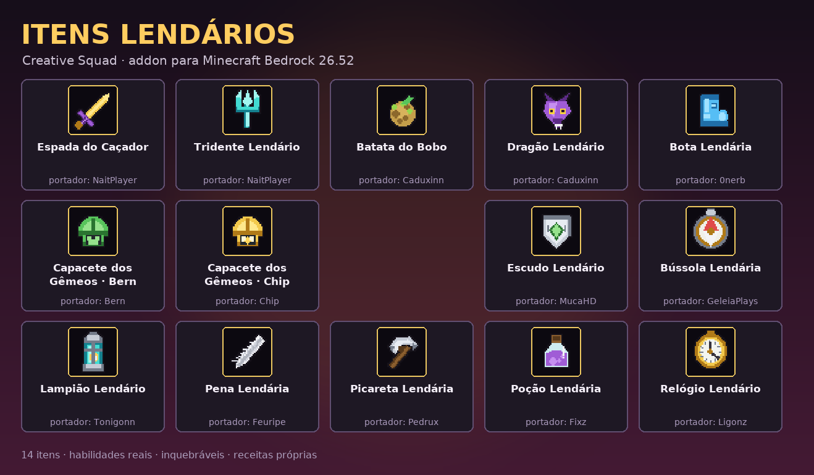

# ⚔️ Itens Lendários da Creative Squad — Addon para Minecraft Bedrock 26.52

Addon completo (comportamento + recursos) que recria os **14 itens lendários da Creative Squad 4**
com as habilidades reais que eles tinham no servidor.



| | |
|---|---|
| **Versão do jogo** | Minecraft Bedrock **26.52** (1.26.52) e superiores |
| **Formato dos itens** | `1.26.30` · **Scripts** `@minecraft/server 2.0.0` |
| **Arquivo pronto** | `release/CreativeSquad_ItensLendarios_26.52.mcaddon` |
| **Idiomas** | Português (pt_BR) e Inglês (en_US) |
| **Requer experimentos?** | **Não.** Só ative os *Beta APIs* se quiser rodar a API de scripts mais nova — o addon foi escrito para funcionar com `2.0.0` estável. |

---

## 📥 Como instalar

1. Baixe **`release/CreativeSquad_ItensLendarios_26.52.mcaddon`**.
2. Toque/clique duas vezes no arquivo (no celular, use "Abrir com Minecraft").
3. O jogo importa **dois pacotes**: `CreativeSquad_ItensLendarios_BP` (comportamento) e `CreativeSquad_ItensLendarios_RP` (recursos).
4. Em **Configurações do mundo → Pacotes de comportamento**, ative o pacote.
   O pacote de recursos é ativado automaticamente (o BP declara a dependência).
5. Entre no mundo. Você verá no chat: *"§aAddon Itens Lendários da Creative Squad carregado!"*

> Também dá para instalar separado com os arquivos `..._BP.mcpack` e `..._RP.mcpack`.

### Pegando os itens

```
/function cs/dar_todos          ← recebe os 14 itens de uma vez
/function cs/ajuda              ← lista de comandos
/function cs/itens/<nome>       ← recebe um item específico
/give @s cs:dragao_lendario     ← pegar direto
```

Ou use a **mesa de trabalho** — todos os 14 itens têm receita própria (veja abaixo).

---

## 🧰 Os 14 itens, com as funções originais

As funções e limitações abaixo vêm da ficha dos Itens Lendários da Creative Squad 4; a coluna
"no addon" mostra como cada uma foi implementada tecnicamente.

| # | Item | Portador | Função (no servidor) | Limitação | Como funciona no addon |
|---|------|----------|----------------------|-----------|------------------------|
| 1 | **Espada do Caçador** | NaitPlayer | Espada de ouro com **Repulsão 10**; quem morre para ela vira o novo portador | Dá **Mau Presságio** permanente no portador | +9 de dano, Repulsão X (empurrão forte), Mau Presságio infinito, e **ao matar um jogador a espada é herdada pela vítima** (ela volta no respawn dele) |
| 2 | **Batata do Bobo** | Caduxinn | Batata envenenada que **anula a velocidade da Bota Lendária** | **Lentidão V** mesmo sem estar na mão | Enquanto estiver no inventário aplica Lentidão V e remove a Velocidade da bota. Comer: Veneno + Náusea… e ela volta pro inventário |
| 3 | **Bota Lendária** | 0nerb | Bota de diamante que deixa o portador **extremamente rápido** | Pode ser anulada pela Batata do Bobo | Calçada: **Velocidade III** + proteção 3. Some na hora se a batata entrar no inventário |
| 4 | **Bússola Lendária** | GeleiaPlays | Localiza **qualquer jogador online**, até invisíveis | — | Mostra nome, distância, direção e coordenadas do jogador mais próximo + rastro de partículas de 8s no alvo |
| 5 | **Capacetes Lendários dos Gêmeos** (Bern e Chip) | Bern / Chip | **+5 corações** de vida e **respiração aquática infinita** | Só funciona se estiver usando; a **vida é compartilhada** com o dono do outro capacete | Vida extra (+4 corações), respiração aquática e **50% do dano que você leva é transferido para o gêmeo** (e vice-versa) |
| 6 | **Dragão Lendário** | Caduxinn | Cabeça de dragão que solta um **bafo com dano** | — | Use: cone de 10 blocos com **Bafo do Dragão**, 8 de dano + Veneno. Recarga 4s |
| 7 | **Escudo Lendário** | MucaHD | Escudo **inquebrável** que solta **Rajada Sônica de Warden** | Tem cooldown e **não pode bloquear ataques** | Use: rajada de 16 blocos, 12 de dano, empurrão forte + Cegueira. Não bloqueia. Recarga 8s |
| 8 | **Lampião Lendário** | Tonigonn | Deixa o usuário **invisível** enquanto segurar | Não esconde elytras, não anula sons, é **anulado pela Bússola** | Invisibilidade infinita **sem partículas** ao segurar (mão ou off-hand); a Bússola ainda consegue localizar |
| 9 | **Pena Lendária** | Feuripe | **Levitação infinita** para quem segura (combo com maça) | **Não protege do dano de queda** | Levitação II enquanto estiver na mão — nada de proteção contra queda |
| 10 | **Picareta Lendária** | Pedrux | Picareta de ferro que **quebra blocos muito rápido** | **Não minera obsidiana e netherita** | Eficiência V + Fortuna III e velocidade de quebra 60x; minerar obsidiana, âncora, netherita ou deepslate reforçado é **cancelado com aviso** |
| 11 | **Poção Lendária** | Fixz | Poção arremessável **infinita** que aplica **cegueira** | — | Use: arremessa em arco (22 blocos), nuvem de 5 blocos com Cegueira II. **Não gasta o item**. Recarga 1,5s |
| 12 | **Relógio Lendário** | Ligonz | Transforma o jogador em **qualquer pessoa online**, copiando skin e nick | — | Use: copia o **nick** do jogador mais próximo por 60s. A skin não pode ser trocada em jogo no Bedrock (limite da edição) |
| 13 | **Tridente Lendário** | NaitPlayer | Tridente poderoso que aplica **cansaço** no alvo | — | +9 de dano, **Cansaço (Fadiga de Mineração) II** por 10s. **Durante tempestade invoca um raio** no alvo (10s de recarga) |
| 14 | **Itens indestrutíveis** | — | Todos os itens lendários são **inquebráveis** | Só se perdem no vazio ou em cactos | Nenhum item tem componente de durabilidade: **nunca quebram** |

Curiosidades que o addon respeita:

* Todos os itens têm o **brilho de encantamento** (glint) mesmo sem encantamentos, como no servidor.
* A **Batata do Bobo** é o único item 100% negativo para o portador.
* Os itens **não aparecem com encantamentos aleatórios** — as propriedades são fixas.

---

## 🛠️ Receitas (mesa de trabalho)

Todos os itens podem ser craftados em survival. Nada de item exclusivo de criativo.

| Item | Receita |
|------|---------|
| **Espada do Caçador** | 2 barras de ouro (na vertical) + 1 graveto |
| **Batata do Bobo** | batata venenosa + olho de aranha + bola de slime |
| **Bota Lendária** | 4 diamantes + 2 penas |
| **Capacete dos Gêmeos · Bern** | 5 escamas de tartaruga + coração do mar |
| **Capacete dos Gêmeos · Chip** | 5 escamas de tartaruga + concha de náutilo |
| **Dragão Lendário** | 4 pérolas do End + 1 bafo de dragão |
| **Escudo Lendário** | 5 barras de ferro + 1 fragmento de eco + 1 escudo |
| **Bússola Lendária** | bússola + olho do End + fragmento de ametista |
| **Lampião Lendário** | lampião + bolsa de tinta brilhante + fragmento de ametista |
| **Pena Lendária** | pena + membrana de phantom + carga de vento |
| **Picareta Lendária** | 3 barras de ferro + 2 gravetos |
| **Poção Lendária** | frasco de vidro + bolsa de tinta + pólvora |
| **Relógio Lendário** | relógio + pérola do End + barra de ouro + etiqueta |
| **Tridente Lendário** | tridente + fragmento de prismarinho + concha de náutilo |

Todas as receitas aparecem automaticamente no **livro de receitas** do jogo.

---

## ⚙️ Como o addon é feito (parte técnica)

```
src/
├── behavior_pack/           (CreativeSquad_ItensLendarios_BP)
│   ├── manifest.json        UUIDs + módulo de script (@minecraft/server 2.0.0)
│   ├── items/               14 JSONs de item (format 1.26.30)
│   ├── recipes/             14 receitas (shaped/shapeless)
│   ├── functions/cs/        16 .mcfunction (dar_todos, ajuda, itens/*)
│   ├── scripts/             main.js, config.js, util.js, passives.js,
│   │                        abilities.js, combat.js, lore.js
│   └── texts/               pt_BR.lang, en_US.lang
└── resource_pack/           (CreativeSquad_ItensLendarios_RP)
    ├── manifest.json
    ├── textures/items/      14 ícones 32x32 desenhados para o addon
    ├── textures/models/     camadas de armadura dos capacetes e da bota
    ├── attachables/         renderização das peças vestidas
    └── texts/               nomes em PT-BR e EN
```

Pontos importantes da implementação:

* **Itens data-driven** (`minecraft:item`) com `minecraft:icon`, `minecraft:wearable`,
  `minecraft:digger`, `minecraft:food`, `minecraft:glint` e `minecraft:tags` (`cs:lendario`).
  Nenhum item tem `minecraft:durability` → **inquebrável** por definição.
* **Habilidades contínuas** (bota, capacete, lampião, pena, batata, espada) rodam em um
  `system.runInterval` de 10 ticks que reaplica os efeitos antes de expirarem — sem "piscar".
* **Habilidades de uso** ficam em `world.afterEvents.itemUse`, com cooldown próprio por item
  (`system.currentTick`, sem depender de scoreboard).
* **Lore/tooltips** e os encantamentos fixos (Repulsão X, Eficiência V, Fortuna III) são aplicados
  por script a cada 2s nos itens que o jogador tem — assim funciona até em itens pegos por
  `/give` sem NBT.
* **API defensiva**: knockback, `applyDamage` e a dupla `getComponent/setEquipment` têm fallback
  para as assinaturas antigas e novas (`applyKnockback` 1.x e 2.x), então o addon não quebra ao
  atualizar o jogo.

### Scripts

| Arquivo | Responsabilidade |
|---------|------------------|
| `main.js` | registra os eventos e os dois loops (`runInterval`) |
| `config.js` | IDs, recargas, amplificadores e blocos proibidos da picareta |
| `util.js` | helpers de equipamento, efeitos, cone de visão, raycast, cooldown |
| `passives.js` | efeitos contínuos + aplicação de lore/encantamentos |
| `abilities.js` | Dragão, Escudo, Poção, Bússola, Relógio, Batata (comer) |
| `combat.js` | Repulsão X, Cansaço/Raio do tridente, vida compartilhada, herança da espada, bloqueio da picareta |

---

## 🧪 Ferramentas de desenvolvimento

O repositório vem com tudo o que é preciso para regerar e conferir o addon:

```bash
python3 tools/gen_textures.py    # desenha as 14 texturas + pack_icon + camadas de armadura
python3 tools/gen_content.py     # gera itens, receitas, lang, item_texture, funções e lore.js
python3 tools/gen_preview.py     # gera docs/preview-itens.png
python3 tools/validate.py        # valida TODOS os JSONs, texturas, receitas e scripts
bash    tools/mock_test.sh       # roda os scripts contra um mock da API (38 testes)
python3 tools/build.py           # valida + empacota release/*.mcaddon
```

O `validate.py` confere, entre outras coisas:

* UUIDs únicos e dependência BP → RP (sem isso o jogo não acha as texturas);
* todo item tem ícone no `item_texture.json`, PNG 32x32 e chave de idioma nos dois `.lang`;
* receitas só usam itens/blocos que existem de verdade (comparado com a
  `vanilladata` oficial do `bedrock-samples`);
* efeitos, encantamentos, partículas e entidades citados nos scripts existem no Bedrock
  (pegou, por exemplo, que **`glowing` não existe** na API → a bússola usa rastro de partículas);
* `tellraw` das funções é JSON válido e todo `give` aponta para um item existente.

`tools/mock_test.sh` simula o jogo em Node.js (inventário, equipamento, efeitos, eventos) e
cobre 38 comportamentos: passivos, cooldowns, herança da espada, vida compartilhada, dano da
picareta, etc.

---

## ❓ Perguntas frequentes

**Precisa de experimentos?**
Não. Os itens usam format `1.26.30`, que já é estável no 26.52, e o script usa a API `2.0.0`
(estável). Se você tiver ativado *Beta APIs* no mundo, o addon continua funcionando — mas
versões beta da API podem mudar assinaturas, e o script foi escrito para tolerar as duas.

**Funciona em versões anteriores, tipo 1.21?**
Os scripts usam `@minecraft/server 2.0.0`, que existe desde a 1.21.90-ish, mas os itens
declaram format `1.26.30`. Em versões antigas o jogo ignora o arquivo de item — **use 26.52 ou mais novo**.

**Funciona em servidor/Realms?**
Sim, é um addon normal de pacotes. Em servidor dedicado, coloque o BP e o RP nas pastas
`behavior_packs/` e `resource_packs/` e registre os dois em `world_behavior_packs.json` /
`world_resource_packs.json`.

**Por que o relógio não muda minha skin?**
A edição Bedrock não permite trocar a skin de um jogador por script. O addon copia o **nick**
(que é o que aparece no chat, na lista de jogadores e na cabeça do nome) por 60 segundos.

**A vida compartilhada dos capacetes mata meu amigo?**
Ela transfere 50% do dano. Se ele estiver com pouca vida, sim — exatamente como no servidor,
onde a vida dos dois era compartilhada. Tire o capacete antes de brigar. 🙂

---

## ⚖️ Créditos e aviso

Addon feito **pela comunidade**, sem vínculo oficial com a Creative Squad, com Mojang ou com
a Microsoft. "Minecraft" é marca da Mojang Studios. Os nomes dos itens e dos participantes
são usados como homenagem à série *Creative Squad 4*.

Licença do código: **MIT** — use, altere e republique à vontade.
