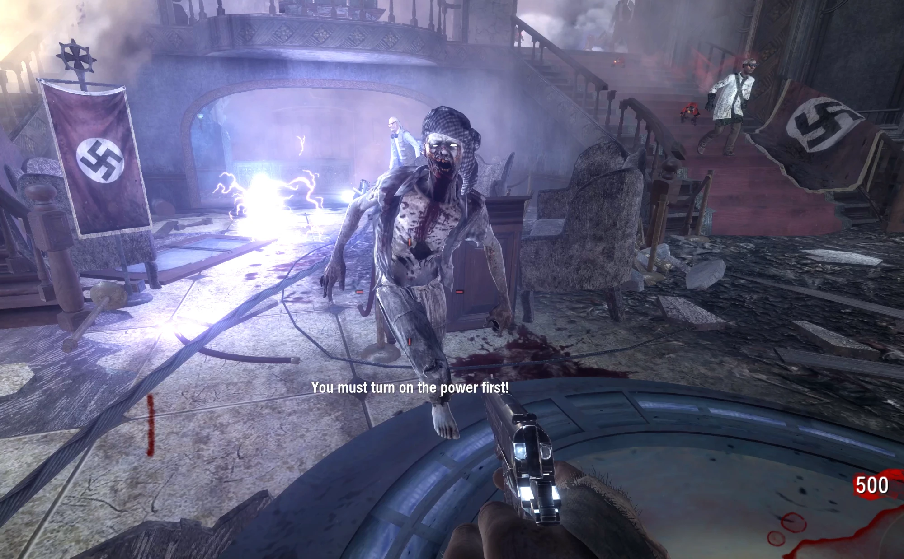

# BO1 Zombies — Modo Online (Firebase)

Este repositório contém o jogo **Call of Duty: Black Ops 1 Zombies** decompilado
(o zip `bo1-zombies-decompiled-main.zip` da release **Vlaude**) + um **modo online**
construído sobre o **Firebase Realtime Database** (projeto `kaka-ca0ff`).



## Modo online — o que foi adicionado

| Parte | Onde | O que é |
|---|---|---|
| **Hub web** | [`online/`](online/README.md) | Salas, convites, pronto?, chat, partida ao vivo, ranking — tudo em tempo real no navegador |
| **Cliente no jogo** | [`src/online/`](src/online/) | REST/WinHTTP para o Realtime Database + builtins GSC (`onlineconnect`, `onlinepoll`, …) |
| **Mod GSC** | [`mods/online/`](mods/online/README.md) | Sincroniza rodadas, vivos, abates, baixas e chat com o hub |
| **Launcher** | [`tools/mod-launcher.hta`](tools/mod-launcher.hta) | Campo "Online (Firebase)" + botão "Abrir hub Online" |

### Hub web (navegador)

```bash
python3 online/serve.py        # http://localhost:8080
```

1. Entre com um apelido.
2. Crie uma sala (mapa, modo, máx. de jogadores) ou entre com um código.
3. Compartilhe o **convite** (link `#sala=CODIGO`), marque **PRONTO** e inicie a partida.
4. Abra em duas janelas e use **SIMULAR PARTIDA (DEMO)** para ver o sync em tempo real.

A página usa o SDK do Firebase empacotado em `online/vendor/firebase-all.js`
(sem CDN) e fala direto com o Realtime Database — não há backend próprio.
Se aparecer `PERMISSION_DENIED`, publique as regras de
[`online/database.rules.json`](online/database.rules.json) no console do Firebase
e ative a autenticação anônima (instruções no [README do hub](online/README.md)).

### No jogo (BO1Zombies.exe)

```powershell
# build: CMake + Visual Studio (WIN32), ver CMakeLists.txt
cd build\Release
.\BO1Zombies.exe +set fs_b $R +set fs_h $R +set bo1_zombies 1 `
  +set fs_mods online +set online_name "SeuNick" +set online_room CODIGO +devmap zombie_theater
```

Ou use o launcher (`tools\mod-launcher.hta`): aba **Online (Firebase)** → apelido → Play.

O mod entra na sala do hub (ou cria uma), publica a rodada/estado a cada segundo e
mostra o chat do hub no console do jogo. Sem internet, o jogo segue normalmente.

## Estrutura

```
online/          hub web do modo online (Firebase JS SDK + RTDB)
src/online/      cliente Firebase do engine (WinHTTP, REST) + builtins GSC
mods/online/     mod GSC (fs_mods online)
src/, mods/, tools/, ...   engine decompilado do BO1 Zombies (release Vlaude)
```

## Sobre o jogo (release Vlaude)

Código decompilado do engine de Black Ops 1 Zombies para modding de engine
(não só scripts/mapas). Instruções de build/mods no comentário de
[`CMakeLists.txt`](CMakeLists.txt), [`Play.bat`](Play.bat) e nas pastas de mods
(`mods/horde`, `mods/nightmare`, `mods/mapkit`, ...). O online original era a nuvem
DemonWare (desativada) — este modo online a substitui pelo Firebase.

---

Projeto de fã sem fins lucrativos, sem afiliação com a Activision.
