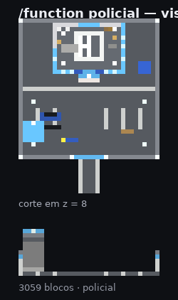
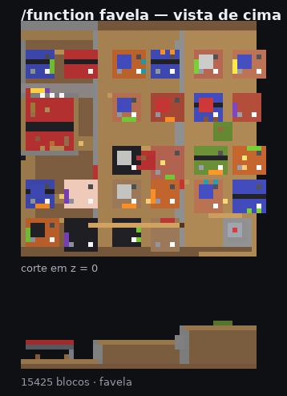

# Arsenal Brasileiro — documentação técnica e integração no TacGuns

Este documento cobre as armas brasileiras **já implementadas no addon** (packs `out/TacGuns(B)` e `out/TacGuns(R)`): 46 armas distribuídas em cinco categorias, todas herdando o comportamento completo das armas originais do TacGuns (disparo, munição, recarga, recarga tática, inspeção, saque, sprint, sway, recuo, pose em terceira pessoa, bancada e contador de munição no HUD).

## Como a herança funciona

Cada arma brasileira foi gerada a partir de uma das cinco plataformas originais. O pipeline copia controladores, animações, eventos, funções e faixa de propriedade e troca apenas o identificador, o modelo voxel, o atlas 128x128 e o ícone:

| Plataforma | Herda de | Pente no jogo | Munição base | Propriedade de recarga |
|---|---|---|---|---|
| rifle | `mk18` | 30 (+1 na câmara) | `tac_guns:556x45mm` | `tac_guns:gunreload` |
| pistol | `glock17` | 18 (+1 na câmara) | `tac_guns:9x19mm` | `tac_guns:coltpythonreload` |
| revolver | `coltpython` | 6 (+1 na câmara) | `tac_guns:357magnum` | `tac_guns:coltpythonreload` |
| sniper | `awp` | 5 (+1 na câmara) | `tac_guns:338lapua` | `tac_guns:gunreload` |
| shotgun | `m870` | 6 (+1 na câmara) | `tac_guns:12gauge` | `mark_variant (escopeta)` |

### Sistemas ativos em todas as armas

- **Equipar / saque** — `animation.<arma>.fp.draw`
- **Inspecionar** — `animation.<arma>.fp.inspect`
- **Disparo (quadril / mira)** — `animation.<arma>.shoot.nsight / shoot.sight`
- **Recarga tática** — `animation.<arma>.fp.tac`
- **Recarga vazia / seca** — `animation.<arma>.fp.reload`
- **Corrida com a arma baixa** — `animation.<arma>.fp.sprint`
- **Pose de terceira pessoa** — `animation.<arma>.tp.hold / tp.crawl`
- **HUD**: `xv<munição no pente>b<munição no inventário>` via `/title @s actionbar`.
- **Troca pente vazio/cheio**: ao zerar o pente o item vira `<arma>_emp` e volta ao atirar com recarga concluída.
- **Bancada**: cada arma tem página própria na aba correspondente do workbench.
- **Sons**: `<arma>.shoot`, `.draw`, `.reload`, `.tacreload`, `.inspect` (gerados a partir da plataforma, prontos para receber gravações próprias).
- **Dano**: script `global.js` (`tacg.bullets`) + entidade `bullet:<arma>`.

### Attachments modulares (implementado)

Cinco acessórios universais são craftáveis na mesa de trabalho e equipáveis em **qualquer** arma brasileira:

| Item | Propriedade sincronizada | Bone no modelo | Encaixe |
|---|---|---|---|
| `tac_guns:att_optic` (Red dot) | `tac_guns:att_optic` | `att_optic` | trilho superior do receptor |
| `tac_guns:att_suppressor` (Supressor) | `tac_guns:att_suppressor` | `att_suppressor` | boca do cano |
| `tac_guns:att_laser` (Lanterna/Laser) | `tac_guns:att_laser` | `att_laser` | trilho inferior/lateral |
| `tac_guns:att_grip` (Foregrip) | `tac_guns:att_grip` | `att_grip` | trilho inferior do guarda-mão |
| `tac_guns:att_exmag` (Carregador estendido) | `tac_guns:att_exmag` | `att_exmag` | poço do carregador |

**Como instalar:** segure o acessório, agache e use (botão de usar). O script `scripts/events/attachments.js` liga a propriedade do jogador, consome 1 item do inventário e o render controller passa a desenhar o bone correspondente. Repetir o gesto remove a peça. Como o estado vive no jogador (propriedade com `client_sync`), a peça aparece em primeira e terceira pessoa e sobrevive à troca de arma.

Os bones de encaixe existem em todas as 26 armas e são filhos do bone do corpo, portanto acompanham o recuo, o sway, a recarga e a animação de inspeção sem nenhum trabalho extra.

## Linha de facção — armas de crime organizado

20 armas inspiradas em apreensões reais, na mesma plataforma de comportamento das demais (disparo, recarga, inspeção, bancada, HUD). O que muda é a linguagem visual e o kit de acessórios:

- **Estética**: metal estampado oxidado, madeira riscada, fita isolante nas junções, numeração raspada e sigla da facção gravada (material `engrave`).
- **Acessórios improvisados** exclusivos: luneta de caça amarrada com fita (`att_tape_optic`) e carregador duplo fitado (`att_dualmag`), além dos cinco acessórios padrão.
- **Bancada**: aba 7 (fuzis de facção) e aba 8 (SMGs, pistolas e escopeta serrada), páginas 1 a 10.

| Arma | Base real | Calibre no mod | Aba/página |
|---|---|---|---|
| AK-47 (facção) (`tac_guns:ak47_crime`) | Izhmash / Norinco / fábricas do leste europeu (contrabando) | `tac_guns:762x39mm` | 7/1 |
| AKM (facção) (`tac_guns:akm_crime`) | União Soviética / Romênia (PM md. 63) / Paraguai | `tac_guns:762x39mm` | 7/2 |
| AK curta / Hellpup (`tac_guns:ak_curta`) | Pioneer Arms (Hellpup) / Zastava M92 / oficinas clandestinas | `tac_guns:762x39mm` | 7/3 |
| AR-15 fantasma (3D) (`tac_guns:ar15_ghost`) | Oficinas clandestinas / impressão 3D (ghost guns) | `tac_guns:556x45mm` | 7/4 |
| M16A1 (contrabando) (`tac_guns:m16_crime`) | Colt (dotação americana dos anos 60/70) | `tac_guns:556x45mm` | 7/5 |
| G3A3 (contrabando) (`tac_guns:g3_crime`) | Heckler & Koch (licenças sul-americanas) | `tac_guns:308winchester` | 7/6 |
| FAL internacional (`tac_guns:fal_crime`) | FN Herstal / FMAP Argentina / Venezuela (desvio) | `tac_guns:308winchester` | 7/7 |
| Carabina SKS (`tac_guns:sks_crime`) | Norinco / Tula (contrabando) | `tac_guns:762x39mm` | 7/8 |
| Ruger Mini-14 (`tac_guns:mini14_crime`) | Sturm, Ruger & Co. (mercado civil / contrabando) | `tac_guns:556x45mm` | 7/9 |
| Mosin-Nagant serrado (`tac_guns:mosin_crime`) | Tula / Izhevsk (relíquias contrabandeadas) | `tac_guns:762x54mmr` | 7/10 |
| Intratec TEC-9 (`tac_guns:tec9`) | Intratec (EUA, produção encerrada) | `tac_guns:9x19mm` | 8/1 |
| TEC-DC9 (`tac_guns:tec_dc9`) | Intratec (variante DC-9 com bandoleira) | `tac_guns:9x19mm` | 8/2 |
| MAC-10 (`tac_guns:mac10`) | Military Armament Corporation (EUA) | `tac_guns:9x19mm` | 8/3 |
| Cobray M11 (.380) (`tac_guns:mac11`) | Cobray / SWD (EUA) | `tac_guns:9x19mm` | 8/4 |
| IWI Uzi (`tac_guns:uzi_crime`) | Israel Military Industries (contrabando) | `tac_guns:9x19mm` | 8/5 |
| Glock + Kit Roni (`tac_guns:kit_roni`) | Roni / CAA (kits importados e clones nacionais) | `tac_guns:9x19mm` | 8/6 |
| Glock 18 (rajada) (`tac_guns:glock18_crime`) | Glock GmbH (peça de seletor de rajada clandestina) | `tac_guns:9x19mm` | 8/7 |
| Espingarda serrada (`tac_guns:sawed_shotgun`) | Oficinas clandestinas (Rossi/Boito serradas) | `tac_guns:12gauge` | 8/8 |
| FGC-9 (impressa) (`tac_guns:fgc9`) | Projeto aberto FGC-9 / oficinas de impressão 3D | `tac_guns:9x19mm` | 8/9 |
| PT24/7 raspada (`tac_guns:pt24_7_raspada`) | Taurus (lote desviado de polícia) | `tac_guns:9x19mm` | 8/10 |

## Fuzis de assalto e batalha

### Imbel IA2 5.56  (`tac_guns:ia2_556`)

**1. Identificação e lore**

- Fabricante: Imbel (Indústria de Material Bélico do Brasil)
- Calibre: 5,56x45 mm NATO — no mod usa `tac_guns:556x45mm`
- Uso: Exército Brasileiro, Fuzileiros Navais, BOPE
- Época: 2010 – atual
- Contexto: Fuzil padrão de dotação das Forças Armadas; projeto nacional com coronha rebatível, trilho superior e empunhadura em polímero.
- Dano no addon: **7.2** por projétil · pente **30** · plataforma `mk18`

**2. Sistema de attachments**

| Acessório | Ponto de encaixe |
|---|---|
| Óptica (trilho superior) | trilho superior (Picatinny), sobre o receptor |
| Supressor 5.56 (boca do cano) | boca do cano, rosca 1/2x28 |
| Foregrip vertical (trilho inferior) | trilho inferior do guarda-mão |
| Lanterna/laser (trilho 3h) | trilho lateral 3h ou 9h |
| Carregador estendido 40 tiros | poço do carregador |
| Coronha telescópica | tubo do receptor traseiro |

No modelo, cada ponto de encaixe é um bone próprio (`att_optic`, `att_suppressor`, `att_grip`, `att_laser`, `att_exmag`) para que a peça possa ser trocada sem editar o corpo da arma.

**3. Diretrizes do modelo 3D**

- Malha voxel: **137 cubos / 822 faces** (atlas único 128x128, 1 material `material.guns`).
- Bones com geometria: `m4a1_body` (58), `magazine` (5), `mk18tp` (63), `att_optic` (4), `att_suppressor` (2), `att_grip` (1), `att_laser` (2), `att_exmag` (2).
- Estilo: voxel com blocos de 1 unidade, sem chanfros; silhueta legível a 3 blocos de distância e mira alinhada ao ponto de visada da câmera.
- Texturização: Polímero preto fosco com desgaste prateado nas arestas de apoio e poeira ocre nas ranhuras do guarda-mão (uso em cerrado).
- Separação de malha (peças móveis em bones independentes): `ferrolho`, `gatilho`, `retém do carregador`, `carregador`, `alavanca de manejo`, `seletor de tiro`, `coronha`, `guarda-mão`.

**4. Animações nativas**

- **Equipar (Draw)**: saque em 0,9 s puxando a alça de manejo — `animation.ia2_556.fp.draw` (reproduzida também no controller `draw` global).
- **Inspecionar (Inspect)**: checagem de câmara + retém do carregador em 5,0 s — `animation.ia2_556.fp.inspect`, disparada com a arma cheia + agachado.
- **Atirar (Fire)**: ciclo de ferrolho de 0,75 s com recuo de 3,4° — `animation.ia2_556.shoot.nsight` (quadril) e `.shoot.sight` (mira), com partículas de boca e de ejeção no locator `<arma>shell`.
- **Recarga tática**: troca de carregador tático em 2,5 s mantendo a mira — `animation.ia2_556.fp.tac` (não descarta o pente, mantém a mira).
- **Recarga vazia**: recarga seca em 3,2 s com liberação do ferrolho — `animation.ia2_556.fp.reload`, termina com `/replaceitem` devolvendo a arma carregada.

*Receita na bancada de trabalho (aba 0, item 3):* 6x `minecraft:iron_ingot`, 1x `minecraft:lapis_lazuli`, 1x `minecraft:oak_log` → `tac_guns:ia2_556_emp` (arma vazia, pronta para municiar).

### Imbel IA2 7.62  (`tac_guns:ia2_762`)

**1. Identificação e lore**

- Fabricante: Imbel
- Calibre: 7,62x51 mm NATO — no mod usa `tac_guns:308winchester`
- Uso: Exército Brasileiro (versão de batalha)
- Época: 2012 – atual
- Contexto: Versão de batalha do IA2 com ferrolho reforçado e cano mais pesado; mesma ergonomia do 5.56 para treinamento cruzado.
- Dano no addon: **9.6** por projétil · pente **30** · plataforma `mk18`

**2. Sistema de attachments**

| Acessório | Ponto de encaixe |
|---|---|
| Óptica 1-4x (trilho superior) | trilho superior (Picatinny), sobre o receptor |
| Supressor 7.62 | boca do cano, rosca 1/2x28 |
| Bipé (trilho inferior) | trilho/rosca padrão |
| Lanterna tática | trilho lateral 3h ou 9h |
| Carregador 25 tiros | poço do carregador |
| Coronha ajustável | tubo do receptor traseiro |

No modelo, cada ponto de encaixe é um bone próprio (`att_optic`, `att_suppressor`, `att_grip`, `att_laser`, `att_exmag`) para que a peça possa ser trocada sem editar o corpo da arma.

**3. Diretrizes do modelo 3D**

- Malha voxel: **125 cubos / 750 faces** (atlas único 128x128, 1 material `material.guns`).
- Bones com geometria: `scar_h_body` (52), `magazine` (5), `mk18tp` (57), `att_optic` (4), `att_suppressor` (2), `att_grip` (1), `att_laser` (2), `att_exmag` (2).
- Estilo: voxel com blocos de 1 unidade, sem chanfros; silhueta legível a 3 blocos de distância e mira alinhada ao ponto de visada da câmera.
- Texturização: Metal fosfatizado escuro com marcas de calor no cano e fita de camuflagem verde-oliva no guarda-mão.
- Separação de malha (peças móveis em bones independentes): `ferrolho`, `gatilho`, `retém`, `carregador`, `alça de manejo`, `bipé`, `coronha`, `guarda-mão`.

**4. Animações nativas**

- **Equipar (Draw)**: saque em 1,1 s com apoio da mão de suporte — `animation.ia2_762.fp.draw` (reproduzida também no controller `draw` global).
- **Inspecionar (Inspect)**: checagem de culatra em 5,3 s — `animation.ia2_762.fp.inspect`, disparada com a arma cheia + agachado.
- **Atirar (Fire)**: recuo de 4,8° em 0,8 s — `animation.ia2_762.shoot.nsight` (quadril) e `.shoot.sight` (mira), com partículas de boca e de ejeção no locator `<arma>shell`.
- **Recarga tática**: troca tática em 2,7 s — `animation.ia2_762.fp.tac` (não descarta o pente, mantém a mira).
- **Recarga vazia**: recarga seca em 3,4 s — `animation.ia2_762.fp.reload`, termina com `/replaceitem` devolvendo a arma carregada.

*Receita na bancada de trabalho (aba 0, item 4):* 6x `minecraft:iron_ingot`, 1x `minecraft:lapis_lazuli`, 1x `minecraft:oak_log` → `tac_guns:ia2_762_emp` (arma vazia, pronta para municiar).

### Imbel MD97L  (`tac_guns:md97l`)

**1. Identificação e lore**

- Fabricante: Imbel
- Calibre: 5,56x45 mm — no mod usa `tac_guns:556x45mm`
- Uso: Exército Brasileiro (reserva), polícias militares
- Época: 1997 – 2010
- Contexto: Antecessor direto do IA2, com coronha esqueletizada e carregador translúcido de 30 tiros.
- Dano no addon: **6.8** por projétil · pente **30** · plataforma `mk18`

**2. Sistema de attachments**

| Acessório | Ponto de encaixe |
|---|---|
| Óptica (trilho superior) | trilho superior (Picatinny), sobre o receptor |
| Supressor 5.56 | boca do cano, rosca 1/2x28 |
| Foregrip curto | trilho inferior do guarda-mão |
| Lanterna | trilho lateral 3h ou 9h |
| Carregador 30 tiros | poço do carregador |
| Coronha esqueletizada | tubo do receptor traseiro |

No modelo, cada ponto de encaixe é um bone próprio (`att_optic`, `att_suppressor`, `att_grip`, `att_laser`, `att_exmag`) para que a peça possa ser trocada sem editar o corpo da arma.

**3. Diretrizes do modelo 3D**

- Malha voxel: **113 cubos / 678 faces** (atlas único 128x128, 1 material `material.guns`).
- Bones com geometria: `g36c_body` (48), `magazine` (3), `mk18tp` (51), `att_optic` (4), `att_suppressor` (2), `att_grip` (1), `att_laser` (2), `att_exmag` (2).
- Estilo: voxel com blocos de 1 unidade, sem chanfros; silhueta legível a 3 blocos de distância e mira alinhada ao ponto de visada da câmera.
- Texturização: Preto acetinado com desgaste intenso no punho e marcas de fita adesiva no guarda-mão.
- Separação de malha (peças móveis em bones independentes): `ferrolho`, `gatilho`, `retém`, `carregador`, `seletor`, `coronha`.

**4. Animações nativas**

- **Equipar (Draw)**: saque em 1,0 s — `animation.md97l.fp.draw` (reproduzida também no controller `draw` global).
- **Inspecionar (Inspect)**: inspeção de 4,9 s girando a arma — `animation.md97l.fp.inspect`, disparada com a arma cheia + agachado.
- **Atirar (Fire)**: 0,72 s por disparo — `animation.md97l.shoot.nsight` (quadril) e `.shoot.sight` (mira), com partículas de boca e de ejeção no locator `<arma>shell`.
- **Recarga tática**: 2,4 s — `animation.md97l.fp.tac` (não descarta o pente, mantém a mira).
- **Recarga vazia**: 3,1 s — `animation.md97l.fp.reload`, termina com `/replaceitem` devolvendo a arma carregada.

*Receita na bancada de trabalho (aba 0, item 5):* 6x `minecraft:iron_ingot`, 1x `minecraft:lapis_lazuli`, 1x `minecraft:oak_log` → `tac_guns:md97l_emp` (arma vazia, pronta para municiar).

### Imbel MD97LM  (`tac_guns:md97lm`)

**1. Identificação e lore**

- Fabricante: Imbel
- Calibre: 5,56x45 mm — no mod usa `tac_guns:556x45mm`
- Uso: Polícia Civil, guardas municipais
- Época: 2000 – atual
- Contexto: Carabina curta derivada do MD97 para patrulhamento urbano e espaços confinados.
- Dano no addon: **6.4** por projétil · pente **30** · plataforma `mk18`

**2. Sistema de attachments**

| Acessório | Ponto de encaixe |
|---|---|
| Red dot (trilho superior) | trilho/rosca padrão |
| Supressor curto | boca do cano, rosca 1/2x28 |
| Foregrip | trilho inferior do guarda-mão |
| Lanterna/laser | trilho lateral 3h ou 9h |
| Carregador 30 tiros | poço do carregador |

No modelo, cada ponto de encaixe é um bone próprio (`att_optic`, `att_suppressor`, `att_grip`, `att_laser`, `att_exmag`) para que a peça possa ser trocada sem editar o corpo da arma.

**3. Diretrizes do modelo 3D**

- Malha voxel: **155 cubos / 930 faces** (atlas único 128x128, 1 material `material.guns`).
- Bones com geometria: `mp5_body` (66), `magazine` (6), `mk18tp` (72), `att_optic` (4), `att_suppressor` (2), `att_grip` (1), `att_laser` (2), `att_exmag` (2).
- Estilo: voxel com blocos de 1 unidade, sem chanfros; silhueta legível a 3 blocos de distância e mira alinhada ao ponto de visada da câmera.
- Texturização: Preto fosco com bastante desgaste no guarda-mão e coronha rebatível.
- Separação de malha (peças móveis em bones independentes): `ferrolho`, `gatilho`, `retém`, `carregador`, `coronha`.

**4. Animações nativas**

- **Equipar (Draw)**: saque em 0,85 s — `animation.md97lm.fp.draw` (reproduzida também no controller `draw` global).
- **Inspecionar (Inspect)**: 4,6 s — `animation.md97lm.fp.inspect`, disparada com a arma cheia + agachado.
- **Atirar (Fire)**: 0,7 s — `animation.md97lm.shoot.nsight` (quadril) e `.shoot.sight` (mira), com partículas de boca e de ejeção no locator `<arma>shell`.
- **Recarga tática**: 2,3 s — `animation.md97lm.fp.tac` (não descarta o pente, mantém a mira).
- **Recarga vazia**: 3,0 s — `animation.md97lm.fp.reload`, termina com `/replaceitem` devolvendo a arma carregada.

*Receita na bancada de trabalho (aba 0, item 6):* 6x `minecraft:iron_ingot`, 1x `minecraft:lapis_lazuli`, 1x `minecraft:oak_log` → `tac_guns:md97lm_emp` (arma vazia, pronta para municiar).

### Imbel M964 FAL  (`tac_guns:m964_fal`)

**1. Identificação e lore**

- Fabricante: Imbel (licença FN Herstal)
- Calibre: 7,62x51 mm NATO — no mod usa `tac_guns:308winchester`
- Uso: Exército Brasileiro, BOPE
- Época: 1964 – atual (reserva)
- Contexto: O clássico “Para-FAL” brasileiro, ícone da infantaria e das operações urbanas; coronha rebatível e punho de madeira.
- Dano no addon: **10.2** por projétil · pente **30** · plataforma `mk18`

**2. Sistema de attachments**

| Acessório | Ponto de encaixe |
|---|---|
| Óptica (trilho aparafusado) | trilho superior (Picatinny), sobre o receptor |
| Supressor 7.62 | boca do cano, rosca 1/2x28 |
| Bipé | trilho/rosca padrão |
| Lanterna | trilho lateral 3h ou 9h |
| Carregador 20 tiros | poço do carregador |
| Coronha rebatível | tubo do receptor traseiro |

No modelo, cada ponto de encaixe é um bone próprio (`att_optic`, `att_suppressor`, `att_grip`, `att_laser`, `att_exmag`) para que a peça possa ser trocada sem editar o corpo da arma.

**3. Diretrizes do modelo 3D**

- Malha voxel: **125 cubos / 750 faces** (atlas único 128x128, 1 material `material.guns`).
- Bones com geometria: `scar_h_body` (52), `magazine` (5), `mk18tp` (57), `att_optic` (4), `att_suppressor` (2), `att_grip` (1), `att_laser` (2), `att_exmag` (2).
- Estilo: voxel com blocos de 1 unidade, sem chanfros; silhueta legível a 3 blocos de distância e mira alinhada ao ponto de visada da câmera.
- Texturização: Parkerização cinza-esverdeada, madeira escurecida por uso e marcas de oxidação nas molas expostas.
- Separação de malha (peças móveis em bones independentes): `ferrolho`, `gatilho`, `retém`, `carregador`, `alavanca de manejo`, `coronha`, `guarda-mão de madeira`.

**4. Animações nativas**

- **Equipar (Draw)**: saque em 1,2 s (arma pesada) — `animation.m964_fal.fp.draw` (reproduzida também no controller `draw` global).
- **Inspecionar (Inspect)**: 5,4 s — `animation.m964_fal.fp.inspect`, disparada com a arma cheia + agachado.
- **Atirar (Fire)**: recuo de 5,2° em 0,82 s — `animation.m964_fal.shoot.nsight` (quadril) e `.shoot.sight` (mira), com partículas de boca e de ejeção no locator `<arma>shell`.
- **Recarga tática**: 3,0 s — `animation.m964_fal.fp.tac` (não descarta o pente, mantém a mira).
- **Recarga vazia**: 3,6 s — `animation.m964_fal.fp.reload`, termina com `/replaceitem` devolvendo a arma carregada.

*Receita na bancada de trabalho (aba 0, item 7):* 6x `minecraft:iron_ingot`, 1x `minecraft:lapis_lazuli`, 1x `minecraft:oak_log` → `tac_guns:m964_fal_emp` (arma vazia, pronta para municiar).

### Imbel MD2  (`tac_guns:md2`)

**1. Identificação e lore**

- Fabricante: Imbel
- Calibre: 5,56x45 mm — no mod usa `tac_guns:556x45mm`
- Uso: Polícia Federal, Força Nacional
- Época: 1985 – 2000
- Contexto: Família MD baseada no FAL convertida para 5,56; precursora da linha que levou ao MD97 e ao IA2.
- Dano no addon: **6.6** por projétil · pente **30** · plataforma `mk18`

**2. Sistema de attachments**

| Acessório | Ponto de encaixe |
|---|---|
| Óptica | trilho superior (Picatinny), sobre o receptor |
| Supressor | boca do cano, rosca 1/2x28 |
| Foregrip | trilho inferior do guarda-mão |
| Lanterna | trilho lateral 3h ou 9h |
| Carregador 30 tiros | poço do carregador |

No modelo, cada ponto de encaixe é um bone próprio (`att_optic`, `att_suppressor`, `att_grip`, `att_laser`, `att_exmag`) para que a peça possa ser trocada sem editar o corpo da arma.

**3. Diretrizes do modelo 3D**

- Malha voxel: **137 cubos / 822 faces** (atlas único 128x128, 1 material `material.guns`).
- Bones com geometria: `m4a1_body` (58), `magazine` (5), `mk18tp` (63), `att_optic` (4), `att_suppressor` (2), `att_grip` (1), `att_laser` (2), `att_exmag` (2).
- Estilo: voxel com blocos de 1 unidade, sem chanfros; silhueta legível a 3 blocos de distância e mira alinhada ao ponto de visada da câmera.
- Texturização: Preto gasto com pontos de ferrugem superficiais e fita de identificação.
- Separação de malha (peças móveis em bones independentes): `ferrolho`, `gatilho`, `retém`, `carregador`, `coronha`.

**4. Animações nativas**

- **Equipar (Draw)**: 1,0 s — `animation.md2.fp.draw` (reproduzida também no controller `draw` global).
- **Inspecionar (Inspect)**: 5,0 s — `animation.md2.fp.inspect`, disparada com a arma cheia + agachado.
- **Atirar (Fire)**: 0,74 s — `animation.md2.shoot.nsight` (quadril) e `.shoot.sight` (mira), com partículas de boca e de ejeção no locator `<arma>shell`.
- **Recarga tática**: 2,5 s — `animation.md2.fp.tac` (não descarta o pente, mantém a mira).
- **Recarga vazia**: 3,2 s — `animation.md2.fp.reload`, termina com `/replaceitem` devolvendo a arma carregada.

*Receita na bancada de trabalho (aba 0, item 8):* 6x `minecraft:iron_ingot`, 1x `minecraft:lapis_lazuli`, 1x `minecraft:oak_log` → `tac_guns:md2_emp` (arma vazia, pronta para municiar).

### Taurus T4  (`tac_guns:t4`)

**1. Identificação e lore**

- Fabricante: Taurus Armas
- Calibre: 5,56x45 mm NATO — no mod usa `tac_guns:556x45mm`
- Uso: Polícias militares, BOPE, mercado civil
- Época: 2014 – atual
- Contexto: Plataforma AR-15 nacional, muito usada por forças táticas pelo custo e pela disponibilidade de peças.
- Dano no addon: **6.9** por projétil · pente **30** · plataforma `mk18`

**2. Sistema de attachments**

| Acessório | Ponto de encaixe |
|---|---|
| Red dot / holográfica (Picatinny) | trilho/rosca padrão |
| Supressor 5.56 | boca do cano, rosca 1/2x28 |
| Foregrip angular | trilho inferior do guarda-mão |
| Lanterna + laser | trilho lateral 3h ou 9h |
| Carregador 30 tiros | poço do carregador |
| Coronha telescópica | tubo do receptor traseiro |

No modelo, cada ponto de encaixe é um bone próprio (`att_optic`, `att_suppressor`, `att_grip`, `att_laser`, `att_exmag`) para que a peça possa ser trocada sem editar o corpo da arma.

**3. Diretrizes do modelo 3D**

- Malha voxel: **155 cubos / 930 faces** (atlas único 128x128, 1 material `material.guns`).
- Bones com geometria: `mp5_body` (66), `magazine` (6), `mk18tp` (72), `att_optic` (4), `att_suppressor` (2), `att_grip` (1), `att_laser` (2), `att_exmag` (2).
- Estilo: voxel com blocos de 1 unidade, sem chanfros; silhueta legível a 3 blocos de distância e mira alinhada ao ponto de visada da câmera.
- Texturização: Cerakote preto com polímero FDE opcional; desgaste nas trilhas do carregador e no freio de boca.
- Separação de malha (peças móveis em bones independentes): `ferrolho (BCG)`, `gatilho`, `retém do carregador`, `carregador`, `alavanca de manejo`, `seletor ambidestro`, `coronha`, `guarda-mão M-LOK`.

**4. Animações nativas**

- **Equipar (Draw)**: 0,9 s — `animation.t4.fp.draw` (reproduzida também no controller `draw` global).
- **Inspecionar (Inspect)**: 5,02 s — `animation.t4.fp.inspect`, disparada com a arma cheia + agachado.
- **Atirar (Fire)**: 0,75 s — `animation.t4.shoot.nsight` (quadril) e `.shoot.sight` (mira), com partículas de boca e de ejeção no locator `<arma>shell`.
- **Recarga tática**: 2,46 s — `animation.t4.fp.tac` (não descarta o pente, mantém a mira).
- **Recarga vazia**: 3,17 s — `animation.t4.fp.reload`, termina com `/replaceitem` devolvendo a arma carregada.

*Receita na bancada de trabalho (aba 0, item 9):* 6x `minecraft:iron_ingot`, 1x `minecraft:lapis_lazuli`, 1x `minecraft:oak_log` → `tac_guns:t4_emp` (arma vazia, pronta para municiar).

### Taurus T4 CQC  (`tac_guns:t4_cqc`)

**1. Identificação e lore**

- Fabricante: Taurus Armas
- Calibre: 5,56x45 mm — no mod usa `tac_guns:556x45mm`
- Uso: Forças táticas, escolta de autoridades
- Época: 2016 – atual
- Contexto: Versão de cano ultracurto (CQC) para combate urbano e proteção de dignitários.
- Dano no addon: **6.3** por projétil · pente **30** · plataforma `mk18`

**2. Sistema de attachments**

| Acessório | Ponto de encaixe |
|---|---|
| Red dot | trilho/rosca padrão |
| Supressor curto | boca do cano, rosca 1/2x28 |
| Foregrip compacto | trilho inferior do guarda-mão |
| Laser | trilho/rosca padrão |
| Carregador 30 tiros | poço do carregador |
| Coronha curta | tubo do receptor traseiro |

No modelo, cada ponto de encaixe é um bone próprio (`att_optic`, `att_suppressor`, `att_grip`, `att_laser`, `att_exmag`) para que a peça possa ser trocada sem editar o corpo da arma.

**3. Diretrizes do modelo 3D**

- Malha voxel: **113 cubos / 678 faces** (atlas único 128x128, 1 material `material.guns`).
- Bones com geometria: `vector_body` (49), `magazine` (2), `mk18tp` (51), `att_optic` (4), `att_suppressor` (2), `att_grip` (1), `att_laser` (2), `att_exmag` (2).
- Estilo: voxel com blocos de 1 unidade, sem chanfros; silhueta legível a 3 blocos de distância e mira alinhada ao ponto de visada da câmera.
- Texturização: Preto fosco com desgaste concentrado no freio de boca e na soleira.
- Separação de malha (peças móveis em bones independentes): `ferrolho`, `gatilho`, `retém`, `carregador`, `coronha`.

**4. Animações nativas**

- **Equipar (Draw)**: 0,8 s — `animation.t4_cqc.fp.draw` (reproduzida também no controller `draw` global).
- **Inspecionar (Inspect)**: 4,8 s — `animation.t4_cqc.fp.inspect`, disparada com a arma cheia + agachado.
- **Atirar (Fire)**: 0,68 s — `animation.t4_cqc.shoot.nsight` (quadril) e `.shoot.sight` (mira), com partículas de boca e de ejeção no locator `<arma>shell`.
- **Recarga tática**: 2,2 s — `animation.t4_cqc.fp.tac` (não descarta o pente, mantém a mira).
- **Recarga vazia**: 2,9 s — `animation.t4_cqc.fp.reload`, termina com `/replaceitem` devolvendo a arma carregada.

*Receita na bancada de trabalho (aba 0, item 10):* 6x `minecraft:iron_ingot`, 1x `minecraft:lapis_lazuli`, 1x `minecraft:oak_log` → `tac_guns:t4_cqc_emp` (arma vazia, pronta para municiar).

## Submetralhadoras

### Taurus/Famae SAF 9mm  (`tac_guns:saf_9mm`)

**1. Identificação e lore**

- Fabricante: Famae / Taurus
- Calibre: 9x19 mm — no mod usa `tac_guns:9x19mm`
- Uso: Polícias militares, Forças Armadas, BOPE
- Época: 1977 – atual
- Contexto: Submetralhadora nacional mais difundida no Brasil; recuo baixo e extremamente compacta com coronha rebatível.
- Dano no addon: **5.6** por projétil · pente **30** · plataforma `mk18`

**2. Sistema de attachments**

| Acessório | Ponto de encaixe |
|---|---|
| Red dot (trilho superior) | trilho/rosca padrão |
| Supressor 9 mm | boca do cano, rosca 1/2x28 |
| Foregrip vertical | trilho inferior do guarda-mão |
| Lanterna | trilho lateral 3h ou 9h |
| Carregador 30 tiros | poço do carregador |
| Coronha rebatível | tubo do receptor traseiro |

No modelo, cada ponto de encaixe é um bone próprio (`att_optic`, `att_suppressor`, `att_grip`, `att_laser`, `att_exmag`) para que a peça possa ser trocada sem editar o corpo da arma.

**3. Diretrizes do modelo 3D**

- Malha voxel: **155 cubos / 930 faces** (atlas único 128x128, 1 material `material.guns`).
- Bones com geometria: `mp5_body` (66), `magazine` (6), `mk18tp` (72), `att_optic` (4), `att_suppressor` (2), `att_grip` (1), `att_laser` (2), `att_exmag` (2).
- Estilo: voxel com blocos de 1 unidade, sem chanfros; silhueta legível a 3 blocos de distância e mira alinhada ao ponto de visada da câmera.
- Texturização: Preto brunitado desgastado no punho; polímero manchado de poeira clara.
- Separação de malha (peças móveis em bones independentes): `ferrolho`, `gatilho`, `retém`, `carregador`, `coronha rebatível`, `alça de manejo`.

**4. Animações nativas**

- **Equipar (Draw)**: 0,75 s — `animation.saf_9mm.fp.draw` (reproduzida também no controller `draw` global).
- **Inspecionar (Inspect)**: 4,4 s — `animation.saf_9mm.fp.inspect`, disparada com a arma cheia + agachado.
- **Atirar (Fire)**: 0,52 s (alta cadência) — `animation.saf_9mm.shoot.nsight` (quadril) e `.shoot.sight` (mira), com partículas de boca e de ejeção no locator `<arma>shell`.
- **Recarga tática**: 1,85 s — `animation.saf_9mm.fp.tac` (não descarta o pente, mantém a mira).
- **Recarga vazia**: 2,15 s — `animation.saf_9mm.fp.reload`, termina com `/replaceitem` devolvendo a arma carregada.

*Receita na bancada de trabalho (aba 5, item 1):* 7x `minecraft:iron_ingot`, 1x `minecraft:gunpowder` → `tac_guns:saf_9mm_emp` (arma vazia, pronta para municiar).

### Famae Mini-SAF  (`tac_guns:mini_saf`)

**1. Identificação e lore**

- Fabricante: Famae
- Calibre: 9x19 mm — no mod usa `tac_guns:9x19mm`
- Uso: Segurança de autoridades, forças especiais
- Época: 1985 – atual
- Contexto: Versão encurtada da SAF, pensada para porte velado e operações em ambientes fechados.
- Dano no addon: **5.1** por projétil · pente **30** · plataforma `mk18`

**2. Sistema de attachments**

| Acessório | Ponto de encaixe |
|---|---|
| Red dot | trilho/rosca padrão |
| Supressor curto | boca do cano, rosca 1/2x28 |
| Foregrip curto | trilho inferior do guarda-mão |
| Laser | trilho/rosca padrão |
| Carregador 20/30 tiros | poço do carregador |

No modelo, cada ponto de encaixe é um bone próprio (`att_optic`, `att_suppressor`, `att_grip`, `att_laser`, `att_exmag`) para que a peça possa ser trocada sem editar o corpo da arma.

**3. Diretrizes do modelo 3D**

- Malha voxel: **115 cubos / 690 faces** (atlas único 128x128, 1 material `material.guns`).
- Bones com geometria: `mp5k_body` (48), `magazine` (4), `mk18tp` (52), `att_optic` (4), `att_suppressor` (2), `att_grip` (1), `att_laser` (2), `att_exmag` (2).
- Estilo: voxel com blocos de 1 unidade, sem chanfros; silhueta legível a 3 blocos de distância e mira alinhada ao ponto de visada da câmera.
- Texturização: Preto fosco com desgaste no topo do ferrolho.
- Separação de malha (peças móveis em bones independentes): `ferrolho`, `gatilho`, `retém`, `carregador`, `coronha`.

**4. Animações nativas**

- **Equipar (Draw)**: 0,65 s — `animation.mini_saf.fp.draw` (reproduzida também no controller `draw` global).
- **Inspecionar (Inspect)**: 4,1 s — `animation.mini_saf.fp.inspect`, disparada com a arma cheia + agachado.
- **Atirar (Fire)**: 0,5 s — `animation.mini_saf.shoot.nsight` (quadril) e `.shoot.sight` (mira), com partículas de boca e de ejeção no locator `<arma>shell`.
- **Recarga tática**: 1,7 s — `animation.mini_saf.fp.tac` (não descarta o pente, mantém a mira).
- **Recarga vazia**: 2,0 s — `animation.mini_saf.fp.reload`, termina com `/replaceitem` devolvendo a arma carregada.

*Receita na bancada de trabalho (aba 5, item 2):* 7x `minecraft:iron_ingot`, 1x `minecraft:gunpowder` → `tac_guns:mini_saf_emp` (arma vazia, pronta para municiar).

### Taurus MT9 G2  (`tac_guns:mt9_g2`)

**1. Identificação e lore**

- Fabricante: Taurus Armas
- Calibre: 9x19 mm — no mod usa `tac_guns:9x19mm`
- Uso: Polícia Civil, guardas municipais
- Época: 2010 – atual
- Contexto: Segunda geração da família MT, com armação em polímero e trilho Picatinny integrado.
- Dano no addon: **5.8** por projétil · pente **30** · plataforma `mk18`

**2. Sistema de attachments**

| Acessório | Ponto de encaixe |
|---|---|
| Red dot | trilho/rosca padrão |
| Supressor 9 mm | boca do cano, rosca 1/2x28 |
| Foregrip | trilho inferior do guarda-mão |
| Lanterna/laser | trilho lateral 3h ou 9h |
| Carregador 30 tiros | poço do carregador |
| Coronha retrátil | tubo do receptor traseiro |

No modelo, cada ponto de encaixe é um bone próprio (`att_optic`, `att_suppressor`, `att_grip`, `att_laser`, `att_exmag`) para que a peça possa ser trocada sem editar o corpo da arma.

**3. Diretrizes do modelo 3D**

- Malha voxel: **119 cubos / 714 faces** (atlas único 128x128, 1 material `material.guns`).
- Bones com geometria: `ump45_body` (49), `magazine` (5), `mk18tp` (54), `att_optic` (4), `att_suppressor` (2), `att_grip` (1), `att_laser` (2), `att_exmag` (2).
- Estilo: voxel com blocos de 1 unidade, sem chanfros; silhueta legível a 3 blocos de distância e mira alinhada ao ponto de visada da câmera.
- Texturização: Polímero preto texturizado, marcas de atrito no guarda-mato.
- Separação de malha (peças móveis em bones independentes): `ferrolho`, `gatilho`, `retém`, `carregador`, `coronha`.

**4. Animações nativas**

- **Equipar (Draw)**: 0,8 s — `animation.mt9_g2.fp.draw` (reproduzida também no controller `draw` global).
- **Inspecionar (Inspect)**: 4,5 s — `animation.mt9_g2.fp.inspect`, disparada com a arma cheia + agachado.
- **Atirar (Fire)**: 0,56 s — `animation.mt9_g2.shoot.nsight` (quadril) e `.shoot.sight` (mira), com partículas de boca e de ejeção no locator `<arma>shell`.
- **Recarga tática**: 1,9 s — `animation.mt9_g2.fp.tac` (não descarta o pente, mantém a mira).
- **Recarga vazia**: 2,2 s — `animation.mt9_g2.fp.reload`, termina com `/replaceitem` devolvendo a arma carregada.

*Receita na bancada de trabalho (aba 5, item 3):* 6x `minecraft:iron_ingot`, 2x `minecraft:gunpowder` → `tac_guns:mt9_g2_emp` (arma vazia, pronta para municiar).

### Taurus SMT9  (`tac_guns:smt9`)

**1. Identificação e lore**

- Fabricante: Taurus Armas
- Calibre: 9x19 mm — no mod usa `tac_guns:9x19mm`
- Uso: Forças táticas, BOPE
- Época: 2019 – atual
- Contexto: Submetralhadora tática moderna com culatra fechada e compatibilidade com acessórios da linha T4.
- Dano no addon: **5.9** por projétil · pente **30** · plataforma `mk18`

**2. Sistema de attachments**

| Acessório | Ponto de encaixe |
|---|---|
| Holográfica | trilho/rosca padrão |
| Supressor 9 mm | boca do cano, rosca 1/2x28 |
| Foregrip angular | trilho inferior do guarda-mão |
| Laser + lanterna | trilho lateral 3h ou 9h |
| Carregador 30 tiros | poço do carregador |
| Coronha telescópica | tubo do receptor traseiro |

No modelo, cada ponto de encaixe é um bone próprio (`att_optic`, `att_suppressor`, `att_grip`, `att_laser`, `att_exmag`) para que a peça possa ser trocada sem editar o corpo da arma.

**3. Diretrizes do modelo 3D**

- Malha voxel: **113 cubos / 678 faces** (atlas único 128x128, 1 material `material.guns`).
- Bones com geometria: `vector_body` (49), `magazine` (2), `mk18tp` (51), `att_optic` (4), `att_suppressor` (2), `att_grip` (1), `att_laser` (2), `att_exmag` (2).
- Estilo: voxel com blocos de 1 unidade, sem chanfros; silhueta legível a 3 blocos de distância e mira alinhada ao ponto de visada da câmera.
- Texturização: Cerakote cinza-escuro com trilhos polidos pelo uso.
- Separação de malha (peças móveis em bones independentes): `ferrolho`, `gatilho`, `retém`, `carregador`, `coronha`, `guarda-mão M-LOK`.

**4. Animações nativas**

- **Equipar (Draw)**: 0,78 s — `animation.smt9.fp.draw` (reproduzida também no controller `draw` global).
- **Inspecionar (Inspect)**: 4,6 s — `animation.smt9.fp.inspect`, disparada com a arma cheia + agachado.
- **Atirar (Fire)**: 0,54 s — `animation.smt9.shoot.nsight` (quadril) e `.shoot.sight` (mira), com partículas de boca e de ejeção no locator `<arma>shell`.
- **Recarga tática**: 1,9 s — `animation.smt9.fp.tac` (não descarta o pente, mantém a mira).
- **Recarga vazia**: 2,25 s — `animation.smt9.fp.reload`, termina com `/replaceitem` devolvendo a arma carregada.

*Receita na bancada de trabalho (aba 5, item 4):* 7x `minecraft:iron_ingot`, 1x `minecraft:gunpowder` → `tac_guns:smt9_emp` (arma vazia, pronta para municiar).

### Mekanika Uru 9mm  (`tac_guns:uru`)

**1. Identificação e lore**

- Fabricante: Mekanika (RJ)
- Calibre: 9x19 mm — no mod usa `tac_guns:9x19mm`
- Uso: Polícias civis e militares (histórica)
- Época: 1974 – 1990
- Contexto: Submetralhadora brasileira dos anos 70/80, robusta e barata; ainda aparece em apreensões e acervos.
- Dano no addon: **5.4** por projétil · pente **30** · plataforma `mk18`

**2. Sistema de attachments**

| Acessório | Ponto de encaixe |
|---|---|
| Óptica pequena | trilho superior (Picatinny), sobre o receptor |
| Supressor (adaptado) | boca do cano, rosca 1/2x28 |
| Carregador 30 tiros | poço do carregador |

No modelo, cada ponto de encaixe é um bone próprio (`att_optic`, `att_suppressor`, `att_grip`, `att_laser`, `att_exmag`) para que a peça possa ser trocada sem editar o corpo da arma.

**3. Diretrizes do modelo 3D**

- Malha voxel: **83 cubos / 498 faces** (atlas único 128x128, 1 material `material.guns`).
- Bones com geometria: `p90_body` (34), `magazine` (2), `mk18tp` (36), `att_optic` (4), `att_suppressor` (2), `att_grip` (1), `att_laser` (2), `att_exmag` (2).
- Estilo: voxel com blocos de 1 unidade, sem chanfros; silhueta legível a 3 blocos de distância e mira alinhada ao ponto de visada da câmera.
- Texturização: Aço escurecido com oxidação e coronha de metal riscado.
- Separação de malha (peças móveis em bones independentes): `ferrolho`, `gatilho`, `retém`, `carregador`, `coronha metálica`.

**4. Animações nativas**

- **Equipar (Draw)**: 0,85 s — `animation.uru.fp.draw` (reproduzida também no controller `draw` global).
- **Inspecionar (Inspect)**: 4,3 s — `animation.uru.fp.inspect`, disparada com a arma cheia + agachado.
- **Atirar (Fire)**: 0,6 s — `animation.uru.shoot.nsight` (quadril) e `.shoot.sight` (mira), com partículas de boca e de ejeção no locator `<arma>shell`.
- **Recarga tática**: 2,0 s — `animation.uru.fp.tac` (não descarta o pente, mantém a mira).
- **Recarga vazia**: 2,4 s — `animation.uru.fp.reload`, termina com `/replaceitem` devolvendo a arma carregada.

*Receita na bancada de trabalho (aba 5, item 5):* 7x `minecraft:iron_ingot`, 1x `minecraft:gunpowder` → `tac_guns:uru_emp` (arma vazia, pronta para municiar).

### Taurus MT12  (`tac_guns:mt12`)

**1. Identificação e lore**

- Fabricante: Taurus / Beretta (licença)
- Calibre: 9x19 mm — no mod usa `tac_guns:9x19mm`
- Uso: Polícia Civil, Forças Armadas
- Época: 1980 – 2010
- Contexto: Cópia nacional da Beretta M12 com culatra telescópica e ferrolho envolvente.
- Dano no addon: **5.5** por projétil · pente **30** · plataforma `mk18`

**2. Sistema de attachments**

| Acessório | Ponto de encaixe |
|---|---|
| Red dot | trilho/rosca padrão |
| Supressor | boca do cano, rosca 1/2x28 |
| Lanterna | trilho lateral 3h ou 9h |
| Carregador 20/32 tiros | poço do carregador |

No modelo, cada ponto de encaixe é um bone próprio (`att_optic`, `att_suppressor`, `att_grip`, `att_laser`, `att_exmag`) para que a peça possa ser trocada sem editar o corpo da arma.

**3. Diretrizes do modelo 3D**

- Malha voxel: **115 cubos / 690 faces** (atlas único 128x128, 1 material `material.guns`).
- Bones com geometria: `mp5k_body` (48), `magazine` (4), `mk18tp` (52), `att_optic` (4), `att_suppressor` (2), `att_grip` (1), `att_laser` (2), `att_exmag` (2).
- Estilo: voxel com blocos de 1 unidade, sem chanfros; silhueta legível a 3 blocos de distância e mira alinhada ao ponto de visada da câmera.
- Texturização: Preto brilhante com desgaste nas laterais do receptor.
- Separação de malha (peças móveis em bones independentes): `ferrolho`, `gatilho`, `retém`, `carregador`, `coronha`.

**4. Animações nativas**

- **Equipar (Draw)**: 0,82 s — `animation.mt12.fp.draw` (reproduzida também no controller `draw` global).
- **Inspecionar (Inspect)**: 4,4 s — `animation.mt12.fp.inspect`, disparada com a arma cheia + agachado.
- **Atirar (Fire)**: 0,58 s — `animation.mt12.shoot.nsight` (quadril) e `.shoot.sight` (mira), com partículas de boca e de ejeção no locator `<arma>shell`.
- **Recarga tática**: 2,0 s — `animation.mt12.fp.tac` (não descarta o pente, mantém a mira).
- **Recarga vazia**: 2,3 s — `animation.mt12.fp.reload`, termina com `/replaceitem` devolvendo a arma carregada.

*Receita na bancada de trabalho (aba 5, item 6):* 7x `minecraft:iron_ingot`, 1x `minecraft:gunpowder` → `tac_guns:mt12_emp` (arma vazia, pronta para municiar).

## Pistolas

### Taurus PT92  (`tac_guns:pt92`)

**1. Identificação e lore**

- Fabricante: Taurus Armas (Beretta 92 sob licença)
- Calibre: 9x19 mm — no mod usa `tac_guns:9x19mm`
- Uso: Polícias militares, Exército
- Época: 1983 – atual
- Contexto: Pistola de serviço com armação de aço e trava de segurança no ferrolho; símbolo do policiamento brasileiro dos anos 90.
- Dano no addon: **5.2** por projétil · pente **18** · plataforma `glock17`

**2. Sistema de attachments**

| Acessório | Ponto de encaixe |
|---|---|
| Red dot (trilho) | placa óptica / trilho curto no ferrolho |
| Supressor 9 mm | boca do cano roscada |
| Lanterna tática | trilho inferior curto |
| Carregador 17/20 tiros | base do punho |

No modelo, cada ponto de encaixe é um bone próprio (`att_optic`, `att_suppressor`, `att_grip`, `att_laser`, `att_exmag`) para que a peça possa ser trocada sem editar o corpo da arma.

**3. Diretrizes do modelo 3D**

- Malha voxel: **61 cubos / 366 faces** (atlas único 128x128, 1 material `material.guns`).
- Bones com geometria: `five_seven_body` (23), `mag` (2), `glock17tp` (25), `att_optic` (4), `att_suppressor` (2), `att_grip` (1), `att_laser` (2), `att_exmag` (2).
- Estilo: voxel com blocos de 1 unidade, sem chanfros; silhueta legível a 3 blocos de distância e mira alinhada ao ponto de visada da câmera.
- Texturização: Aço azulado com facetas prateadas nos cantos e empunhadura de madeira ou borracha.
- Separação de malha (peças móveis em bones independentes): `ferrolho`, `cano`, `gatilho`, `retém do carregador`, `carregador`, `martelo`, `trava de segurança`.

**4. Animações nativas**

- **Equipar (Draw)**: 0,55 s — `animation.pt92.fp.draw` (reproduzida também no controller `draw` global).
- **Inspecionar (Inspect)**: 4,11 s — `animation.pt92.fp.inspect`, disparada com a arma cheia + agachado.
- **Atirar (Fire)**: 0,35 s (recuo 2,1°) — `animation.pt92.shoot.nsight` (quadril) e `.shoot.sight` (mira), com partículas de boca e de ejeção no locator `<arma>shell`.
- **Recarga tática**: 1,85 s — `animation.pt92.fp.tac` (não descarta o pente, mantém a mira).
- **Recarga vazia**: 2,15 s — `animation.pt92.fp.reload`, termina com `/replaceitem` devolvendo a arma carregada.

*Receita na bancada de trabalho (aba 2, item 3):* 7x `minecraft:iron_ingot`, 1x `minecraft:quartz` → `tac_guns:pt92_emp` (arma vazia, pronta para municiar).

### Taurus PT24/7  (`tac_guns:pt24_7`)

**1. Identificação e lore**

- Fabricante: Taurus Armas
- Calibre: 9x19 mm / .40 S&W — no mod usa `tac_guns:9x19mm`
- Uso: Polícia Civil, segurança privada
- Época: 2000 – 2015
- Contexto: Pistola policial com sistema “24/7” de prontidão e indicador de câmara carregada.
- Dano no addon: **5.0** por projétil · pente **18** · plataforma `glock17`

**2. Sistema de attachments**

| Acessório | Ponto de encaixe |
|---|---|
| Red dot | placa óptica / trilho curto no ferrolho |
| Supressor | boca do cano roscada |
| Lanterna | trilho inferior curto |
| Carregador 15/17 tiros | base do punho |

No modelo, cada ponto de encaixe é um bone próprio (`att_optic`, `att_suppressor`, `att_grip`, `att_laser`, `att_exmag`) para que a peça possa ser trocada sem editar o corpo da arma.

**3. Diretrizes do modelo 3D**

- Malha voxel: **61 cubos / 366 faces** (atlas único 128x128, 1 material `material.guns`).
- Bones com geometria: `five_seven_body` (23), `mag` (2), `glock17tp` (25), `att_optic` (4), `att_suppressor` (2), `att_grip` (1), `att_laser` (2), `att_exmag` (2).
- Estilo: voxel com blocos de 1 unidade, sem chanfros; silhueta legível a 3 blocos de distância e mira alinhada ao ponto de visada da câmera.
- Texturização: Polímero preto com insertos de borracha e desgaste no trilho.
- Separação de malha (peças móveis em bones independentes): `ferrolho`, `cano`, `gatilho`, `retém`, `carregador`, `martelo`.

**4. Animações nativas**

- **Equipar (Draw)**: 0,52 s — `animation.pt24_7.fp.draw` (reproduzida também no controller `draw` global).
- **Inspecionar (Inspect)**: 4,0 s — `animation.pt24_7.fp.inspect`, disparada com a arma cheia + agachado.
- **Atirar (Fire)**: 0,33 s — `animation.pt24_7.shoot.nsight` (quadril) e `.shoot.sight` (mira), com partículas de boca e de ejeção no locator `<arma>shell`.
- **Recarga tática**: 1,8 s — `animation.pt24_7.fp.tac` (não descarta o pente, mantém a mira).
- **Recarga vazia**: 2,1 s — `animation.pt24_7.fp.reload`, termina com `/replaceitem` devolvendo a arma carregada.

*Receita na bancada de trabalho (aba 2, item 4):* 7x `minecraft:iron_ingot`, 1x `minecraft:quartz` → `tac_guns:pt24_7_emp` (arma vazia, pronta para municiar).

### Taurus TS9  (`tac_guns:ts9`)

**1. Identificação e lore**

- Fabricante: Taurus Armas
- Calibre: 9x19 mm — no mod usa `tac_guns:9x19mm`
- Uso: Polícia Militar, Polícia Federal
- Época: 2015 – atual
- Contexto: Pistola striker-fired adotada em concursos e editais de segurança pública pelo gatilho constante.
- Dano no addon: **5.1** por projétil · pente **18** · plataforma `glock17`

**2. Sistema de attachments**

| Acessório | Ponto de encaixe |
|---|---|
| Red dot | placa óptica / trilho curto no ferrolho |
| Supressor | boca do cano roscada |
| Lanterna | trilho inferior curto |
| Carregador 17 tiros | base do punho |

No modelo, cada ponto de encaixe é um bone próprio (`att_optic`, `att_suppressor`, `att_grip`, `att_laser`, `att_exmag`) para que a peça possa ser trocada sem editar o corpo da arma.

**3. Diretrizes do modelo 3D**

- Malha voxel: **61 cubos / 366 faces** (atlas único 128x128, 1 material `material.guns`).
- Bones com geometria: `five_seven_body` (23), `mag` (2), `glock17tp` (25), `att_optic` (4), `att_suppressor` (2), `att_grip` (1), `att_laser` (2), `att_exmag` (2).
- Estilo: voxel com blocos de 1 unidade, sem chanfros; silhueta legível a 3 blocos de distância e mira alinhada ao ponto de visada da câmera.
- Texturização: Preto fosco com textura aderente no punho e desgaste no serrilhado.
- Separação de malha (peças móveis em bones independentes): `ferrolho`, `cano`, `gatilho`, `retém`, `carregador`, `extrator`.

**4. Animações nativas**

- **Equipar (Draw)**: 0,5 s — `animation.ts9.fp.draw` (reproduzida também no controller `draw` global).
- **Inspecionar (Inspect)**: 3,9 s — `animation.ts9.fp.inspect`, disparada com a arma cheia + agachado.
- **Atirar (Fire)**: 0,32 s — `animation.ts9.shoot.nsight` (quadril) e `.shoot.sight` (mira), com partículas de boca e de ejeção no locator `<arma>shell`.
- **Recarga tática**: 1,75 s — `animation.ts9.fp.tac` (não descarta o pente, mantém a mira).
- **Recarga vazia**: 2,05 s — `animation.ts9.fp.reload`, termina com `/replaceitem` devolvendo a arma carregada.

*Receita na bancada de trabalho (aba 2, item 5):* 7x `minecraft:iron_ingot`, 1x `minecraft:quartz` → `tac_guns:ts9_emp` (arma vazia, pronta para municiar).

### Taurus TH9  (`tac_guns:th9`)

**1. Identificação e lore**

- Fabricante: Taurus Armas
- Calibre: 9x19 mm — no mod usa `tac_guns:9x19mm`
- Uso: Polícias militares, CAC
- Época: 2017 – atual
- Contexto: Martelo externo, armação completa e trilho para red dot; projetada para o mercado de segurança pública.
- Dano no addon: **5.3** por projétil · pente **18** · plataforma `glock17`

**2. Sistema de attachments**

| Acessório | Ponto de encaixe |
|---|---|
| Red dot (placa óptica) | placa óptica / trilho curto no ferrolho |
| Supressor 9 mm | boca do cano roscada |
| Lanterna | trilho inferior curto |
| Carregador 17/20 tiros | base do punho |

No modelo, cada ponto de encaixe é um bone próprio (`att_optic`, `att_suppressor`, `att_grip`, `att_laser`, `att_exmag`) para que a peça possa ser trocada sem editar o corpo da arma.

**3. Diretrizes do modelo 3D**

- Malha voxel: **61 cubos / 366 faces** (atlas único 128x128, 1 material `material.guns`).
- Bones com geometria: `five_seven_body` (23), `mag` (2), `glock17tp` (25), `att_optic` (4), `att_suppressor` (2), `att_grip` (1), `att_laser` (2), `att_exmag` (2).
- Estilo: voxel com blocos de 1 unidade, sem chanfros; silhueta legível a 3 blocos de distância e mira alinhada ao ponto de visada da câmera.
- Texturização: Preto mate com desgaste leve e poeira nas reentrâncias do punho.
- Separação de malha (peças móveis em bones independentes): `ferrolho`, `cano`, `gatilho`, `retém`, `carregador`, `martelo`, `trava ambidestra`.

**4. Animações nativas**

- **Equipar (Draw)**: 0,53 s — `animation.th9.fp.draw` (reproduzida também no controller `draw` global).
- **Inspecionar (Inspect)**: 4,05 s — `animation.th9.fp.inspect`, disparada com a arma cheia + agachado.
- **Atirar (Fire)**: 0,33 s — `animation.th9.shoot.nsight` (quadril) e `.shoot.sight` (mira), com partículas de boca e de ejeção no locator `<arma>shell`.
- **Recarga tática**: 1,8 s — `animation.th9.fp.tac` (não descarta o pente, mantém a mira).
- **Recarga vazia**: 2,1 s — `animation.th9.fp.reload`, termina com `/replaceitem` devolvendo a arma carregada.

*Receita na bancada de trabalho (aba 2, item 6):* 7x `minecraft:iron_ingot`, 1x `minecraft:quartz` → `tac_guns:th9_emp` (arma vazia, pronta para municiar).

### Taurus G3c  (`tac_guns:g3c`)

**1. Identificação e lore**

- Fabricante: Taurus Armas
- Calibre: 9x19 mm — no mod usa `tac_guns:9x19mm`
- Uso: Porte velado, polícias civis
- Época: 2020 – atual
- Contexto: Compacta de 12+1, uma das pistolas mais vendidas do mundo; gatilho curto e mira em fibra óptica.
- Dano no addon: **4.8** por projétil · pente **18** · plataforma `glock17`

**2. Sistema de attachments**

| Acessório | Ponto de encaixe |
|---|---|
| Red dot | placa óptica / trilho curto no ferrolho |
| Supressor compacto | boca do cano roscada |
| Lanterna mini | trilho inferior curto |
| Carregador 12/15 tiros | base do punho |

No modelo, cada ponto de encaixe é um bone próprio (`att_optic`, `att_suppressor`, `att_grip`, `att_laser`, `att_exmag`) para que a peça possa ser trocada sem editar o corpo da arma.

**3. Diretrizes do modelo 3D**

- Malha voxel: **61 cubos / 366 faces** (atlas único 128x128, 1 material `material.guns`).
- Bones com geometria: `five_seven_body` (23), `mag` (2), `glock17tp` (25), `att_optic` (4), `att_suppressor` (2), `att_grip` (1), `att_laser` (2), `att_exmag` (2).
- Estilo: voxel com blocos de 1 unidade, sem chanfros; silhueta legível a 3 blocos de distância e mira alinhada ao ponto de visada da câmera.
- Texturização: Polímero preto texturizado, desgaste no topo do ferrolho.
- Separação de malha (peças móveis em bones independentes): `ferrolho`, `cano`, `gatilho`, `retém`, `carregador`, `extrator`.

**4. Animações nativas**

- **Equipar (Draw)**: 0,48 s — `animation.g3c.fp.draw` (reproduzida também no controller `draw` global).
- **Inspecionar (Inspect)**: 3,8 s — `animation.g3c.fp.inspect`, disparada com a arma cheia + agachado.
- **Atirar (Fire)**: 0,31 s — `animation.g3c.shoot.nsight` (quadril) e `.shoot.sight` (mira), com partículas de boca e de ejeção no locator `<arma>shell`.
- **Recarga tática**: 1,7 s — `animation.g3c.fp.tac` (não descarta o pente, mantém a mira).
- **Recarga vazia**: 2,0 s — `animation.g3c.fp.reload`, termina com `/replaceitem` devolvendo a arma carregada.

*Receita na bancada de trabalho (aba 2, item 7):* 7x `minecraft:iron_ingot`, 1x `minecraft:quartz` → `tac_guns:g3c_emp` (arma vazia, pronta para municiar).

### Taurus GX4  (`tac_guns:gx4`)

**1. Identificação e lore**

- Fabricante: Taurus Armas
- Calibre: 9x19 mm — no mod usa `tac_guns:9x19mm`
- Uso: Porte velado, forças de segurança
- Época: 2021 – atual
- Contexto: Micro-compacta de 11+1 com chassi de aço inox; pensada para uso dissimulado.
- Dano no addon: **4.6** por projétil · pente **18** · plataforma `glock17`

**2. Sistema de attachments**

| Acessório | Ponto de encaixe |
|---|---|
| Red dot micro | placa óptica / trilho curto no ferrolho |
| Supressor compacto | boca do cano roscada |
| Lanterna mini | trilho inferior curto |
| Carregador 11/13 tiros | base do punho |

No modelo, cada ponto de encaixe é um bone próprio (`att_optic`, `att_suppressor`, `att_grip`, `att_laser`, `att_exmag`) para que a peça possa ser trocada sem editar o corpo da arma.

**3. Diretrizes do modelo 3D**

- Malha voxel: **61 cubos / 366 faces** (atlas único 128x128, 1 material `material.guns`).
- Bones com geometria: `five_seven_body` (23), `mag` (2), `glock17tp` (25), `att_optic` (4), `att_suppressor` (2), `att_grip` (1), `att_laser` (2), `att_exmag` (2).
- Estilo: voxel com blocos de 1 unidade, sem chanfros; silhueta legível a 3 blocos de distância e mira alinhada ao ponto de visada da câmera.
- Texturização: Inox escovado com armação preta e marcas de uso no gatilho.
- Separação de malha (peças móveis em bones independentes): `ferrolho`, `cano`, `gatilho`, `retém`, `carregador`.

**4. Animações nativas**

- **Equipar (Draw)**: 0,45 s — `animation.gx4.fp.draw` (reproduzida também no controller `draw` global).
- **Inspecionar (Inspect)**: 3,7 s — `animation.gx4.fp.inspect`, disparada com a arma cheia + agachado.
- **Atirar (Fire)**: 0,3 s — `animation.gx4.shoot.nsight` (quadril) e `.shoot.sight` (mira), com partículas de boca e de ejeção no locator `<arma>shell`.
- **Recarga tática**: 1,65 s — `animation.gx4.fp.tac` (não descarta o pente, mantém a mira).
- **Recarga vazia**: 1,95 s — `animation.gx4.fp.reload`, termina com `/replaceitem` devolvendo a arma carregada.

*Receita na bancada de trabalho (aba 2, item 8):* 7x `minecraft:iron_ingot`, 1x `minecraft:quartz` → `tac_guns:gx4_emp` (arma vazia, pronta para municiar).

## Revólveres

### Taurus RT85  (`tac_guns:rt85`)

**1. Identificação e lore**

- Fabricante: Taurus Armas
- Calibre: .38 Special — no mod usa `tac_guns:357magnum`
- Uso: Vigilantes, porte civil, polícias
- Época: 1980 – atual
- Contexto: Revólver de 5 tiros em .38 Special, leve e barato; presença massiva no mercado civil brasileiro.
- Dano no addon: **13.0** por projétil · pente **6** · plataforma `coltpython`

**2. Sistema de attachments**

| Acessório | Ponto de encaixe |
|---|---|
| Mira de fibra óptica (substitui a fixa) | trilho do cano (substitui a mira fixa) |
| Cilindro extra (recarga rápida) | conjunto do tambor |

No modelo, cada ponto de encaixe é um bone próprio (`att_optic`, `att_suppressor`, `att_grip`, `att_laser`, `att_exmag`) para que a peça possa ser trocada sem editar o corpo da arma.

**3. Diretrizes do modelo 3D**

- Malha voxel: **73 cubos / 438 faces** (atlas único 128x128, 1 material `material.guns`).
- Bones com geometria: `model29_body` (30), `hammer2` (1), `coltpythontp` (31), `att_optic` (4), `att_suppressor` (2), `att_grip` (1), `att_laser` (2), `att_exmag` (2).
- Estilo: voxel com blocos de 1 unidade, sem chanfros; silhueta legível a 3 blocos de distância e mira alinhada ao ponto de visada da câmera.
- Texturização: Aço inox fosco com riscos de coldre e fuligem nos alvéolos.
- Separação de malha (peças móveis em bones independentes): `tambor`, `martelo`, `gatilho`, `cão`, `ejetor`, `trava do tambor`.

**4. Animações nativas**

- **Equipar (Draw)**: 0,62 s — `animation.rt85.fp.draw` (reproduzida também no controller `draw` global).
- **Inspecionar (Inspect)**: 5,79 s girando o tambor — `animation.rt85.fp.inspect`, disparada com a arma cheia + agachado.
- **Atirar (Fire)**: 0,45 s com recuo de 3,2° — `animation.rt85.shoot.nsight` (quadril) e `.shoot.sight` (mira), com partículas de boca e de ejeção no locator `<arma>shell`.
- **Recarga tática**: recarga rápida de 6 tiros — `animation.rt85.fp.tac` (não descarta o pente, mantém a mira).
- **Recarga vazia**: recarga completa com ejetor — `animation.rt85.fp.reload`, termina com `/replaceitem` devolvendo a arma carregada.

*Receita na bancada de trabalho (aba 2, item 9):* 1x `minecraft:gold_ingot`, 6x `minecraft:iron_ingot`, 1x `minecraft:quartz` → `tac_guns:rt85_emp` (arma vazia, pronta para municiar).

### Taurus RT608  (`tac_guns:rt608`)

**1. Identificação e lore**

- Fabricante: Taurus Armas
- Calibre: .357 Magnum — no mod usa `tac_guns:357magnum`
- Uso: Caça, tiro esportivo, vigilância
- Época: 1990 – atual
- Contexto: Revólver de 8 tiros com cano de 6 polegadas e compensador de boca; muito usado em vigilância rural.
- Dano no addon: **15.5** por projétil · pente **6** · plataforma `coltpython`

**2. Sistema de attachments**

| Acessório | Ponto de encaixe |
|---|---|
| Red dot (trilho no cano) | trilho/rosca padrão |
| Cilindro extra | conjunto do tambor |
| Coronilha de mira | trilho do cano (substitui a mira fixa) |

No modelo, cada ponto de encaixe é um bone próprio (`att_optic`, `att_suppressor`, `att_grip`, `att_laser`, `att_exmag`) para que a peça possa ser trocada sem editar o corpo da arma.

**3. Diretrizes do modelo 3D**

- Malha voxel: **73 cubos / 438 faces** (atlas único 128x128, 1 material `material.guns`).
- Bones com geometria: `model29_body` (30), `hammer2` (1), `coltpythontp` (31), `att_optic` (4), `att_suppressor` (2), `att_grip` (1), `att_laser` (2), `att_exmag` (2).
- Estilo: voxel com blocos de 1 unidade, sem chanfros; silhueta legível a 3 blocos de distância e mira alinhada ao ponto de visada da câmera.
- Texturização: Inox polido com fuligem no compensador e desgaste na empunhadura.
- Separação de malha (peças móveis em bones independentes): `tambor`, `martelo`, `gatilho`, `ejetor`, `cano ventilado`.

**4. Animações nativas**

- **Equipar (Draw)**: 0,7 s — `animation.rt608.fp.draw` (reproduzida também no controller `draw` global).
- **Inspecionar (Inspect)**: 5,9 s — `animation.rt608.fp.inspect`, disparada com a arma cheia + agachado.
- **Atirar (Fire)**: 0,5 s (recuo 4,4°) — `animation.rt608.shoot.nsight` (quadril) e `.shoot.sight` (mira), com partículas de boca e de ejeção no locator `<arma>shell`.
- **Recarga tática**: recarga rápida — `animation.rt608.fp.tac` (não descarta o pente, mantém a mira).
- **Recarga vazia**: recarga completa — `animation.rt608.fp.reload`, termina com `/replaceitem` devolvendo a arma carregada.

*Receita na bancada de trabalho (aba 2, item 10):* 1x `minecraft:gold_ingot`, 6x `minecraft:iron_ingot`, 1x `minecraft:quartz` → `tac_guns:rt608_emp` (arma vazia, pronta para municiar).

### Taurus Raging Bull .454  (`tac_guns:raging_bull`)

**1. Identificação e lore**

- Fabricante: Taurus Armas
- Calibre: .454 Casull — no mod usa `tac_guns:50ae`
- Uso: Caça maior, tiro esportivo
- Época: 1997 – atual
- Contexto: Revólver pesado com quadro reforçado e compensador integrado; referência em caça de grande porte.
- Dano no addon: **19.0** por projétil · pente **6** · plataforma `coltpython`

**2. Sistema de attachments**

| Acessório | Ponto de encaixe |
|---|---|
| Red dot | trilho/rosca padrão |
| Cilindro extra | conjunto do tambor |
| Massa de mira de fibra | trilho do cano (substitui a mira fixa) |

No modelo, cada ponto de encaixe é um bone próprio (`att_optic`, `att_suppressor`, `att_grip`, `att_laser`, `att_exmag`) para que a peça possa ser trocada sem editar o corpo da arma.

**3. Diretrizes do modelo 3D**

- Malha voxel: **69 cubos / 414 faces** (atlas único 128x128, 1 material `material.guns`).
- Bones com geometria: `judge_body` (28), `hammer2` (1), `coltpythontp` (29), `att_optic` (4), `att_suppressor` (2), `att_grip` (1), `att_laser` (2), `att_exmag` (2).
- Estilo: voxel com blocos de 1 unidade, sem chanfros; silhueta legível a 3 blocos de distância e mira alinhada ao ponto de visada da câmera.
- Texturização: Aço escuro com jateamento e marcas de fuligem intensa.
- Separação de malha (peças móveis em bones independentes): `tambor`, `martelo`, `gatilho`, `ejetor`, `compensador`.

**4. Animações nativas**

- **Equipar (Draw)**: 0,8 s — `animation.raging_bull.fp.draw` (reproduzida também no controller `draw` global).
- **Inspecionar (Inspect)**: 6,0 s — `animation.raging_bull.fp.inspect`, disparada com a arma cheia + agachado.
- **Atirar (Fire)**: 0,55 s (recuo 5,6°) — `animation.raging_bull.shoot.nsight` (quadril) e `.shoot.sight` (mira), com partículas de boca e de ejeção no locator `<arma>shell`.
- **Recarga tática**: recarga rápida — `animation.raging_bull.fp.tac` (não descarta o pente, mantém a mira).
- **Recarga vazia**: recarga completa — `animation.raging_bull.fp.reload`, termina com `/replaceitem` devolvendo a arma carregada.

*Receita na bancada de trabalho (aba 2, item 11):* 1x `minecraft:gold_ingot`, 6x `minecraft:iron_ingot`, 1x `minecraft:diamond` → `tac_guns:raging_bull_emp` (arma vazia, pronta para municiar).

## Fuzil de precisão

### Imbel AGLC  (`tac_guns:aglc`)

**1. Identificação e lore**

- Fabricante: Imbel
- Calibre: 7,62x51 mm NATO (.308 Win) — no mod usa `tac_guns:308winchester`
- Uso: Exército Brasileiro (precisão), BOPE
- Época: 2010 – atual
- Contexto: Fuzil de precisão de ferrolho do Exército, com cano flutuante e culatra de repetição manual.
- Dano no addon: **32.0** por projétil · pente **5** · plataforma `awp`

**2. Sistema de attachments**

| Acessório | Ponto de encaixe |
|---|---|
| Luneta 3-12x (trilho) | trilho superior, sobre a culatra |
| Supressor .308 | boca do cano roscada |
| Bipé | trilho inferior / swivel |
| Saco de apoio | trilho/rosca padrão |
| Carregador 5/10 tiros | poço do carregador |

No modelo, cada ponto de encaixe é um bone próprio (`att_optic`, `att_suppressor`, `att_grip`, `att_laser`, `att_exmag`) para que a peça possa ser trocada sem editar o corpo da arma.

**3. Diretrizes do modelo 3D**

- Malha voxel: **129 cubos / 774 faces** (atlas único 128x128, 1 material `material.guns`).
- Bones com geometria: `intervention_body` (55), `bolt` (2), `maga` (2), `awptp` (59), `att_optic` (4), `att_suppressor` (2), `att_grip` (1), `att_laser` (2), `att_exmag` (2).
- Estilo: voxel com blocos de 1 unidade, sem chanfros; silhueta legível a 3 blocos de distância e mira alinhada ao ponto de visada da câmera.
- Texturização: Verde-oliva com rede de camuflagem e desgaste no ferrolho.
- Separação de malha (peças móveis em bones independentes): `ferrolho (bolt)`, `gatilho`, `retém`, `carregador`, `coronha ajustável`, `bipé`, `luneta`.

**4. Animações nativas**

- **Equipar (Draw)**: 1,3 s — `animation.aglc.fp.draw` (reproduzida também no controller `draw` global).
- **Inspecionar (Inspect)**: 4,96 s — `animation.aglc.fp.inspect`, disparada com a arma cheia + agachado.
- **Atirar (Fire)**: 0,9 s com ciclo de ferrolho — `animation.aglc.shoot.nsight` (quadril) e `.shoot.sight` (mira), com partículas de boca e de ejeção no locator `<arma>shell`.
- **Recarga tática**: recarga tática 2,9 s — `animation.aglc.fp.tac` (não descarta o pente, mantém a mira).
- **Recarga vazia**: recarga seca 3,5 s — `animation.aglc.fp.reload`, termina com `/replaceitem` devolvendo a arma carregada.

*Receita na bancada de trabalho (aba 4, item 3):* 1x `minecraft:diamond`, 1x `minecraft:gold_ingot`, 6x `minecraft:iron_ingot` → `tac_guns:aglc_emp` (arma vazia, pronta para municiar).

## Escopetas táticas

### Taurus ST12  (`tac_guns:st12`)

**1. Identificação e lore**

- Fabricante: Taurus Armas
- Calibre: 12 gauge — no mod usa `tac_guns:12gauge`
- Uso: Polícia Militar, BOPE, Força Nacional
- Época: 2015 – atual
- Contexto: Escopeta tática de bombeamento com coronha retrátil e trilho para acessórios; padrão em viaturas.
- Dano no addon: **5.2** por projétil · pente **6** · plataforma `m870`

**2. Sistema de attachments**

| Acessório | Ponto de encaixe |
|---|---|
| Red dot | trilho superior do receptor |
| Lanterna/laser (trilho) | trilho lateral do guarda-mão |
| Coronha retrátil | traseira do receptor |
| Tube extensor 7+1 | tubo carregador sob o cano |
| Choke de boca | trilho/rosca padrão |

No modelo, cada ponto de encaixe é um bone próprio (`att_optic`, `att_suppressor`, `att_grip`, `att_laser`, `att_exmag`) para que a peça possa ser trocada sem editar o corpo da arma.

**3. Diretrizes do modelo 3D**

- Malha voxel: **113 cubos / 678 faces** (atlas único 128x128, 1 material `material.guns`).
- Bones com geometria: `spas12_body` (51), `m870tp` (51), `att_optic` (4), `att_suppressor` (2), `att_grip` (1), `att_laser` (2), `att_exmag` (2).
- Estilo: voxel com blocos de 1 unidade, sem chanfros; silhueta legível a 3 blocos de distância e mira alinhada ao ponto de visada da câmera.
- Texturização: Preto fosco com polímero texturizado e desgaste no guarda-mão.
- Separação de malha (peças móveis em bones independentes): `bombeamento (pump)`, `ferrolho`, `gatilho`, `retém`, `tubo carregador`, `coronha`.

**4. Animações nativas**

- **Equipar (Draw)**: 0,9 s — `animation.st12.fp.draw` (reproduzida também no controller `draw` global).
- **Inspecionar (Inspect)**: 4,46 s — `animation.st12.fp.inspect`, disparada com a arma cheia + agachado.
- **Atirar (Fire)**: 0,7 s — `animation.st12.shoot.nsight` (quadril) e `.shoot.sight` (mira), com partículas de boca e de ejeção no locator `<arma>shell`.
- **Recarga tática**: recarga tática de 0,55 s por cartucho — `animation.st12.fp.tac` (não descarta o pente, mantém a mira).
- **Recarga vazia**: recarga seca com liberação do pump — `animation.st12.fp.reload`, termina com `/replaceitem` devolvendo a arma carregada.

*Receita na bancada de trabalho (aba 3, item 3):* 6x `minecraft:iron_ingot`, 1x `minecraft:lapis_lazuli`, 1x `minecraft:oak_log` → `tac_guns:st12_emp` (arma vazia, pronta para municiar).

### CBC Military 3.0  (`tac_guns:cbc_military`)

**1. Identificação e lore**

- Fabricante: CBC (Companhia Brasileira de Cartuchos)
- Calibre: 12 gauge — no mod usa `tac_guns:12gauge`
- Uso: Exército, polícias
- Época: 2018 – atual
- Contexto: Escopeta de bombeamento padrão de dotação, simples e resistente, usada em guarda de instalações.
- Dano no addon: **4.9** por projétil · pente **6** · plataforma `m870`

**2. Sistema de attachments**

| Acessório | Ponto de encaixe |
|---|---|
| Lanterna | trilho lateral do guarda-mão |
| Coronha tática | traseira do receptor |
| Tube extensor | tubo carregador sob o cano |

No modelo, cada ponto de encaixe é um bone próprio (`att_optic`, `att_suppressor`, `att_grip`, `att_laser`, `att_exmag`) para que a peça possa ser trocada sem editar o corpo da arma.

**3. Diretrizes do modelo 3D**

- Malha voxel: **91 cubos / 546 faces** (atlas único 128x128, 1 material `material.guns`).
- Bones com geometria: `slide` (8), `nova_body` (32), `m870tp` (40), `att_optic` (4), `att_suppressor` (2), `att_grip` (1), `att_laser` (2), `att_exmag` (2).
- Estilo: voxel com blocos de 1 unidade, sem chanfros; silhueta legível a 3 blocos de distância e mira alinhada ao ponto de visada da câmera.
- Texturização: Preto com coronha de polímero e marcas de uso na soleira.
- Separação de malha (peças móveis em bones independentes): `bombeamento`, `ferrolho`, `gatilho`, `tubo carregador`.

**4. Animações nativas**

- **Equipar (Draw)**: 0,95 s — `animation.cbc_military.fp.draw` (reproduzida também no controller `draw` global).
- **Inspecionar (Inspect)**: 4,46 s — `animation.cbc_military.fp.inspect`, disparada com a arma cheia + agachado.
- **Atirar (Fire)**: 0,72 s — `animation.cbc_military.shoot.nsight` (quadril) e `.shoot.sight` (mira), com partículas de boca e de ejeção no locator `<arma>shell`.
- **Recarga tática**: recarga por cartucho (0,55 s) — `animation.cbc_military.fp.tac` (não descarta o pente, mantém a mira).
- **Recarga vazia**: recarga seca — `animation.cbc_military.fp.reload`, termina com `/replaceitem` devolvendo a arma carregada.

*Receita na bancada de trabalho (aba 3, item 4):* 6x `minecraft:iron_ingot`, 1x `minecraft:lapis_lazuli`, 1x `minecraft:oak_log` → `tac_guns:cbc_military_emp` (arma vazia, pronta para municiar).

## Facção — fuzis

### AK-47 (facção)  (`tac_guns:ak47_crime`)

**1. Identificação e lore**

- Fabricante: Izhmash / Norinco / fábricas do leste europeu (contrabando)
- Calibre: 7,62x39 mm — no mod usa `tac_guns:762x39mm`
- Uso: Comando Vermelho, PCC, milícias
- Época: 1949 – atual
- Contexto: O fuzil mais icônico das facções: entrou pelo Paraguai e pelo mercado de guerra; madeira riscada, ferrugem e sigla da facção gravada na coronha.
- Dano no addon: **9.0** por projétil · pente **30** · plataforma `mk18`

**2. Sistema de attachments**

| Acessório | Ponto de encaixe |
|---|---|
| Mira de caça amarrada com fita isolante | trilho/rosca padrão |
| Carregador duplo preso com fita | poço do carregador |
| Supressor artesanal (tubo de rosca adaptado) | boca do cano, rosca 1/2x28 |
| Coronha serrada | tubo do receptor traseiro |

No modelo, cada ponto de encaixe é um bone próprio (`att_optic`, `att_suppressor`, `att_grip`, `att_laser`, `att_exmag`, `att_tape_optic`, `att_dualmag` (improvisados)) para que a peça possa ser trocada sem editar o corpo da arma.

**3. Diretrizes do modelo 3D**

- Malha voxel: **109 cubos / 654 faces** (atlas único 128x128, 1 material `material.guns`).
- Bones com geometria: `ak47_body` (40), `magazine` (6), `mk18tp` (46), `att_optic` (4), `att_suppressor` (2), `att_grip` (1), `att_laser` (2), `att_exmag` (2), `att_tape_optic` (4), `att_dualmag` (2).
- Estilo: voxel com blocos de 1 unidade, sem chanfros; silhueta legível a 3 blocos de distância e mira alinhada ao ponto de visada da câmera.
- Texturização: Madeira escurecida e lascada, ferrugem nas peças estampadas, fita isolante preta no guarda-mão e marcação vermelha da facção na coronha.
- Separação de malha (peças móveis em bones independentes): `ferrolho`, `alavanca de manejo`, `gatilho`, `carregador curvo`, `coronha`.

**4. Animações nativas**

- **Equipar (Draw)**: 1,0 s (arma pesada, puxada do coldre de pano) — `animation.ak47_crime.fp.draw` (reproduzida também no controller `draw` global).
- **Inspecionar (Inspect)**: checagem de ferrolho em 5,4 s — `animation.ak47_crime.fp.inspect`, disparada com a arma cheia + agachado.
- **Atirar (Fire)**: recuo alto de 5,8° em 0,82 s — `animation.ak47_crime.shoot.nsight` (quadril) e `.shoot.sight` (mira), com partículas de boca e de ejeção no locator `<arma>shell`.
- **Recarga tática**: troca com dois carregadores fitados em 3,0 s — `animation.ak47_crime.fp.tac` (não descarta o pente, mantém a mira).
- **Recarga vazia**: recarga seca em 3,6 s — `animation.ak47_crime.fp.reload`, termina com `/replaceitem` devolvendo a arma carregada.

*Receita na bancada de trabalho (aba 7, item 1):* 7x `minecraft:iron_ingot`, 1x `minecraft:oak_log` → `tac_guns:ak47_crime_emp` (arma vazia, pronta para municiar).

### AKM (facção)  (`tac_guns:akm_crime`)

**1. Identificação e lore**

- Fabricante: União Soviética / Romênia (PM md. 63) / Paraguai
- Calibre: 7,62x39 mm — no mod usa `tac_guns:762x39mm`
- Uso: Facções do RJ e SP, milícias
- Época: 1959 – atual
- Contexto: Versão modernizada do AK com coronha de madeira e empunhadura frontal; é a variante mais apreendida em operações.
- Dano no addon: **9.3** por projétil · pente **30** · plataforma `mk18`

**2. Sistema de attachments**

| Acessório | Ponto de encaixe |
|---|---|
| Mira de ponto vermelho barata (trilho colado) | trilho/rosca padrão |
| Carregador duplo fitado | poço do carregador |
| Freio de boca substituído por rosca artesanal | trilho/rosca padrão |

No modelo, cada ponto de encaixe é um bone próprio (`att_optic`, `att_suppressor`, `att_grip`, `att_laser`, `att_exmag`, `att_tape_optic`, `att_dualmag` (improvisados)) para que a peça possa ser trocada sem editar o corpo da arma.

**3. Diretrizes do modelo 3D**

- Malha voxel: **109 cubos / 654 faces** (atlas único 128x128, 1 material `material.guns`).
- Bones com geometria: `ak47_body` (40), `magazine` (6), `mk18tp` (46), `att_optic` (4), `att_suppressor` (2), `att_grip` (1), `att_laser` (2), `att_exmag` (2), `att_tape_optic` (4), `att_dualmag` (2).
- Estilo: voxel com blocos de 1 unidade, sem chanfros; silhueta legível a 3 blocos de distância e mira alinhada ao ponto de visada da câmera.
- Texturização: Madeira envernizada gasta, metal com oxidação e inscrições feitas à faca.
- Separação de malha (peças móveis em bones independentes): `ferrolho`, `alavanca de manejo`, `gatilho`, `carregador`, `coronha`.

**4. Animações nativas**

- **Equipar (Draw)**: 1,0 s — `animation.akm_crime.fp.draw` (reproduzida também no controller `draw` global).
- **Inspecionar (Inspect)**: 5,3 s — `animation.akm_crime.fp.inspect`, disparada com a arma cheia + agachado.
- **Atirar (Fire)**: 0,8 s com recuo de 5,6° — `animation.akm_crime.shoot.nsight` (quadril) e `.shoot.sight` (mira), com partículas de boca e de ejeção no locator `<arma>shell`.
- **Recarga tática**: 3,0 s — `animation.akm_crime.fp.tac` (não descarta o pente, mantém a mira).
- **Recarga vazia**: 3,5 s — `animation.akm_crime.fp.reload`, termina com `/replaceitem` devolvendo a arma carregada.

*Receita na bancada de trabalho (aba 7, item 2):* 7x `minecraft:iron_ingot`, 1x `minecraft:oak_log` → `tac_guns:akm_crime_emp` (arma vazia, pronta para municiar).

### AK curta / Hellpup  (`tac_guns:ak_curta`)

**1. Identificação e lore**

- Fabricante: Pioneer Arms (Hellpup) / Zastava M92 / oficinas clandestinas
- Calibre: 7,62x39 mm — no mod usa `tac_guns:762x39mm`
- Uso: Assaltos a carro-forte, escoltas de facção
- Época: 1990 – atual
- Contexto: AK de cano curtíssimo e coronha dobrada, preferido para assaltos dentro de veículos e emboscadas em becos.
- Dano no addon: **8.4** por projétil · pente **30** · plataforma `mk18`

**2. Sistema de attachments**

| Acessório | Ponto de encaixe |
|---|---|
| Mira de caça com fita | trilho/rosca padrão |
| Carregador duplo fitado | poço do carregador |
| Punho de fita | trilho/rosca padrão |

No modelo, cada ponto de encaixe é um bone próprio (`att_optic`, `att_suppressor`, `att_grip`, `att_laser`, `att_exmag`, `att_tape_optic`, `att_dualmag` (improvisados)) para que a peça possa ser trocada sem editar o corpo da arma.

**3. Diretrizes do modelo 3D**

- Malha voxel: **85 cubos / 510 faces** (atlas único 128x128, 1 material `material.guns`).
- Bones com geometria: `ak_short_body` (30), `magazine` (4), `mk18tp` (34), `att_optic` (4), `att_suppressor` (2), `att_grip` (1), `att_laser` (2), `att_exmag` (2), `att_tape_optic` (4), `att_dualmag` (2).
- Estilo: voxel com blocos de 1 unidade, sem chanfros; silhueta legível a 3 blocos de distância e mira alinhada ao ponto de visada da câmera.
- Texturização: Metal nu com ferrugem avançada e fita isolante no guarda-mão.
- Separação de malha (peças móveis em bones independentes): `ferrolho`, `gatilho`, `carregador`, `coronha de arame`.

**4. Animações nativas**

- **Equipar (Draw)**: 0,85 s — `animation.ak_curta.fp.draw` (reproduzida também no controller `draw` global).
- **Inspecionar (Inspect)**: 4,8 s — `animation.ak_curta.fp.inspect`, disparada com a arma cheia + agachado.
- **Atirar (Fire)**: 0,8 s com clarão de boca alto — `animation.ak_curta.shoot.nsight` (quadril) e `.shoot.sight` (mira), com partículas de boca e de ejeção no locator `<arma>shell`.
- **Recarga tática**: 2,6 s — `animation.ak_curta.fp.tac` (não descarta o pente, mantém a mira).
- **Recarga vazia**: 3,1 s — `animation.ak_curta.fp.reload`, termina com `/replaceitem` devolvendo a arma carregada.

*Receita na bancada de trabalho (aba 7, item 3):* 7x `minecraft:iron_ingot`, 1x `minecraft:oak_log` → `tac_guns:ak_curta_emp` (arma vazia, pronta para municiar).

### AR-15 fantasma (3D)  (`tac_guns:ar15_ghost`)

**1. Identificação e lore**

- Fabricante: Oficinas clandestinas / impressão 3D (ghost guns)
- Calibre: 5,56x45 mm — no mod usa `tac_guns:556x45mm`
- Uso: Facções, milícias e CACs ilegais
- Época: 2020 – atual
- Contexto: Recebedor impresso em 3D e peças usinadas sem número de série; apreendido em linhas de montagem dentro de comunidades.
- Dano no addon: **7.0** por projétil · pente **30** · plataforma `mk18`

**2. Sistema de attachments**

| Acessório | Ponto de encaixe |
|---|---|
| Mira improvisada em trilho impresso | trilho/rosca padrão |
| Carregador fitado | poço do carregador |
| Junções reforçadas com fita | trilho/rosca padrão |

No modelo, cada ponto de encaixe é um bone próprio (`att_optic`, `att_suppressor`, `att_grip`, `att_laser`, `att_exmag`, `att_tape_optic`, `att_dualmag` (improvisados)) para que a peça possa ser trocada sem editar o corpo da arma.

**3. Diretrizes do modelo 3D**

- Malha voxel: **75 cubos / 450 faces** (atlas único 128x128, 1 material `material.guns`).
- Bones com geometria: `ghost_ar_body` (26), `magazine` (3), `mk18tp` (29), `att_optic` (4), `att_suppressor` (2), `att_grip` (1), `att_laser` (2), `att_exmag` (2), `att_tape_optic` (4), `att_dualmag` (2).
- Estilo: voxel com blocos de 1 unidade, sem chanfros; silhueta legível a 3 blocos de distância e mira alinhada ao ponto de visada da câmera.
- Texturização: Polímero impresso sem acabamento, camadas visíveis, fita isolante nas junções e marcação de facção em vermelho.
- Separação de malha (peças móveis em bones independentes): `ferrolho`, `gatilho`, `carregador`, `coronha impressa`.

**4. Animações nativas**

- **Equipar (Draw)**: 0,9 s — `animation.ar15_ghost.fp.draw` (reproduzida também no controller `draw` global).
- **Inspecionar (Inspect)**: 5,0 s — `animation.ar15_ghost.fp.inspect`, disparada com a arma cheia + agachado.
- **Atirar (Fire)**: 0,75 s — `animation.ar15_ghost.shoot.nsight` (quadril) e `.shoot.sight` (mira), com partículas de boca e de ejeção no locator `<arma>shell`.
- **Recarga tática**: 2,4 s — `animation.ar15_ghost.fp.tac` (não descarta o pente, mantém a mira).
- **Recarga vazia**: 3,1 s — `animation.ar15_ghost.fp.reload`, termina com `/replaceitem` devolvendo a arma carregada.

*Receita na bancada de trabalho (aba 7, item 4):* 7x `minecraft:iron_ingot`, 1x `minecraft:coal_block` → `tac_guns:ar15_ghost_emp` (arma vazia, pronta para municiar).

### M16A1 (contrabando)  (`tac_guns:m16_crime`)

**1. Identificação e lore**

- Fabricante: Colt (dotação americana dos anos 60/70)
- Calibre: 5,56x45 mm — no mod usa `tac_guns:556x45mm`
- Uso: Arsenais de tráfico no RJ e na fronteira
- Época: 1967 – atual
- Contexto: Fuzil militar antigo desviado de arsenais sul-americanos; coronha triangular e empunhadura desgastada.
- Dano no addon: **7.2** por projétil · pente **30** · plataforma `mk18`

**2. Sistema de attachments**

| Acessório | Ponto de encaixe |
|---|---|
| Mira de caça amarrada | trilho/rosca padrão |
| Carregador duplo com fita | poço do carregador |
| Coronha serrada | tubo do receptor traseiro |

No modelo, cada ponto de encaixe é um bone próprio (`att_optic`, `att_suppressor`, `att_grip`, `att_laser`, `att_exmag`, `att_tape_optic`, `att_dualmag` (improvisados)) para que a peça possa ser trocada sem editar o corpo da arma.

**3. Diretrizes do modelo 3D**

- Malha voxel: **143 cubos / 858 faces** (atlas único 128x128, 1 material `material.guns`).
- Bones com geometria: `m4a1_body` (58), `magazine` (5), `mk18tp` (63), `att_optic` (4), `att_suppressor` (2), `att_grip` (1), `att_laser` (2), `att_exmag` (2), `att_tape_optic` (4), `att_dualmag` (2).
- Estilo: voxel com blocos de 1 unidade, sem chanfros; silhueta legível a 3 blocos de distância e mira alinhada ao ponto de visada da câmera.
- Texturização: Preto descascado com alumínio exposto, poeira e marcas de fita.
- Separação de malha (peças móveis em bones independentes): `ferrolho`, `gatilho`, `carregador`, `coronha`, `guarda-mão`.

**4. Animações nativas**

- **Equipar (Draw)**: 0,95 s — `animation.m16_crime.fp.draw` (reproduzida também no controller `draw` global).
- **Inspecionar (Inspect)**: 5,0 s — `animation.m16_crime.fp.inspect`, disparada com a arma cheia + agachado.
- **Atirar (Fire)**: 0,75 s — `animation.m16_crime.shoot.nsight` (quadril) e `.shoot.sight` (mira), com partículas de boca e de ejeção no locator `<arma>shell`.
- **Recarga tática**: 2,5 s — `animation.m16_crime.fp.tac` (não descarta o pente, mantém a mira).
- **Recarga vazia**: 3,2 s — `animation.m16_crime.fp.reload`, termina com `/replaceitem` devolvendo a arma carregada.

*Receita na bancada de trabalho (aba 7, item 5):* 7x `minecraft:iron_ingot`, 1x `minecraft:coal_block` → `tac_guns:m16_crime_emp` (arma vazia, pronta para municiar).

### G3A3 (contrabando)  (`tac_guns:g3_crime`)

**1. Identificação e lore**

- Fabricante: Heckler & Koch (licenças sul-americanas)
- Calibre: 7,62x51 mm NATO — no mod usa `tac_guns:308winchester`
- Uso: Quadrilhas de assalto a banco, milícias rurais
- Época: 1964 – atual
- Contexto: Fuzil de batalha pesado usado para poder de fogo em confrontos abertos; coronha fixa e carregador de 20 tiros.
- Dano no addon: **10.0** por projétil · pente **30** · plataforma `mk18`

**2. Sistema de attachments**

| Acessório | Ponto de encaixe |
|---|---|
| Mira telescópica de caça amarrada com arame | trilho/rosca padrão |
| Carregador duplo fitado | poço do carregador |

No modelo, cada ponto de encaixe é um bone próprio (`att_optic`, `att_suppressor`, `att_grip`, `att_laser`, `att_exmag`, `att_tape_optic`, `att_dualmag` (improvisados)) para que a peça possa ser trocada sem editar o corpo da arma.

**3. Diretrizes do modelo 3D**

- Malha voxel: **131 cubos / 786 faces** (atlas único 128x128, 1 material `material.guns`).
- Bones com geometria: `scar_h_body` (52), `magazine` (5), `mk18tp` (57), `att_optic` (4), `att_suppressor` (2), `att_grip` (1), `att_laser` (2), `att_exmag` (2), `att_tape_optic` (4), `att_dualmag` (2).
- Estilo: voxel com blocos de 1 unidade, sem chanfros; silhueta legível a 3 blocos de distância e mira alinhada ao ponto de visada da câmera.
- Texturização: Metal oxidado, coronha de polímero rachada e arame unindo a luneta ao recebedor.
- Separação de malha (peças móveis em bones independentes): `ferrolho`, `gatilho`, `carregador`, `coronha`.

**4. Animações nativas**

- **Equipar (Draw)**: 1,15 s — `animation.g3_crime.fp.draw` (reproduzida também no controller `draw` global).
- **Inspecionar (Inspect)**: 5,4 s — `animation.g3_crime.fp.inspect`, disparada com a arma cheia + agachado.
- **Atirar (Fire)**: 0,84 s com recuo de 6,1° — `animation.g3_crime.shoot.nsight` (quadril) e `.shoot.sight` (mira), com partículas de boca e de ejeção no locator `<arma>shell`.
- **Recarga tática**: 3,0 s — `animation.g3_crime.fp.tac` (não descarta o pente, mantém a mira).
- **Recarga vazia**: 3,6 s — `animation.g3_crime.fp.reload`, termina com `/replaceitem` devolvendo a arma carregada.

*Receita na bancada de trabalho (aba 7, item 6):* 7x `minecraft:iron_ingot`, 1x `minecraft:coal_block` → `tac_guns:g3_crime_emp` (arma vazia, pronta para municiar).

### FAL internacional  (`tac_guns:fal_crime`)

**1. Identificação e lore**

- Fabricante: FN Herstal / FMAP Argentina / Venezuela (desvio)
- Calibre: 7,62x51 mm NATO — no mod usa `tac_guns:308winchester`
- Uso: Facções com ligação na fronteira norte e sul
- Época: 1953 – atual
- Contexto: FAL de fabricação estrangeira com marcações militares raspadas, muito usado em emboscadas contra blindados.
- Dano no addon: **10.4** por projétil · pente **30** · plataforma `mk18`

**2. Sistema de attachments**

| Acessório | Ponto de encaixe |
|---|---|
| Mira de caça com fita | trilho/rosca padrão |
| Carregador duplo | poço do carregador |
| Coronha rebatível soldada | tubo do receptor traseiro |

No modelo, cada ponto de encaixe é um bone próprio (`att_optic`, `att_suppressor`, `att_grip`, `att_laser`, `att_exmag`, `att_tape_optic`, `att_dualmag` (improvisados)) para que a peça possa ser trocada sem editar o corpo da arma.

**3. Diretrizes do modelo 3D**

- Malha voxel: **131 cubos / 786 faces** (atlas único 128x128, 1 material `material.guns`).
- Bones com geometria: `scar_h_body` (52), `magazine` (5), `mk18tp` (57), `att_optic` (4), `att_suppressor` (2), `att_grip` (1), `att_laser` (2), `att_exmag` (2), `att_tape_optic` (4), `att_dualmag` (2).
- Estilo: voxel com blocos de 1 unidade, sem chanfros; silhueta legível a 3 blocos de distância e mira alinhada ao ponto de visada da câmera.
- Texturização: Parkerização gasta com ferrugem e marcas de solda na coronha.
- Separação de malha (peças móveis em bones independentes): `ferrolho`, `gatilho`, `carregador`, `coronha`, `guarda-mão`.

**4. Animações nativas**

- **Equipar (Draw)**: 1,1 s — `animation.fal_crime.fp.draw` (reproduzida também no controller `draw` global).
- **Inspecionar (Inspect)**: 5,3 s — `animation.fal_crime.fp.inspect`, disparada com a arma cheia + agachado.
- **Atirar (Fire)**: 0,86 s — `animation.fal_crime.shoot.nsight` (quadril) e `.shoot.sight` (mira), com partículas de boca e de ejeção no locator `<arma>shell`.
- **Recarga tática**: 3,0 s — `animation.fal_crime.fp.tac` (não descarta o pente, mantém a mira).
- **Recarga vazia**: 3,5 s — `animation.fal_crime.fp.reload`, termina com `/replaceitem` devolvendo a arma carregada.

*Receita na bancada de trabalho (aba 7, item 7):* 7x `minecraft:iron_ingot`, 1x `minecraft:oak_log` → `tac_guns:fal_crime_emp` (arma vazia, pronta para municiar).

### Carabina SKS  (`tac_guns:sks_crime`)

**1. Identificação e lore**

- Fabricante: Norinco / Tula (contrabando)
- Calibre: 7,62x39 mm — no mod usa `tac_guns:762x39mm`
- Uso: Quadrilhas rurais, novo cangaco
- Época: 1945 – atual
- Contexto: Carabina semiautomática de madeira com pente fixo; comum em roubos a banco no interior e em assentamentos.
- Dano no addon: **8.2** por projétil · pente **30** · plataforma `mk18`

**2. Sistema de attachments**

| Acessório | Ponto de encaixe |
|---|---|
| Mira de caça amarrada | trilho/rosca padrão |
| Pente fixo ampliado artesanal | trilho/rosca padrão |

No modelo, cada ponto de encaixe é um bone próprio (`att_optic`, `att_suppressor`, `att_grip`, `att_laser`, `att_exmag`, `att_tape_optic`, `att_dualmag` (improvisados)) para que a peça possa ser trocada sem editar o corpo da arma.

**3. Diretrizes do modelo 3D**

- Malha voxel: **73 cubos / 438 faces** (atlas único 128x128, 1 material `material.guns`).
- Bones com geometria: `sks_body` (27), `magazine` (1), `mk18tp` (28), `att_optic` (4), `att_suppressor` (2), `att_grip` (1), `att_laser` (2), `att_exmag` (2), `att_tape_optic` (4), `att_dualmag` (2).
- Estilo: voxel com blocos de 1 unidade, sem chanfros; silhueta legível a 3 blocos de distância e mira alinhada ao ponto de visada da câmera.
- Texturização: Madeira clara manchada de graxa, ferrolho polido pelo uso.
- Separação de malha (peças móveis em bones independentes): `ferrolho`, `gatilho`, `pente fixo`, `coronha`.

**4. Animações nativas**

- **Equipar (Draw)**: 1,05 s — `animation.sks_crime.fp.draw` (reproduzida também no controller `draw` global).
- **Inspecionar (Inspect)**: 5,1 s — `animation.sks_crime.fp.inspect`, disparada com a arma cheia + agachado.
- **Atirar (Fire)**: 0,8 s — `animation.sks_crime.shoot.nsight` (quadril) e `.shoot.sight` (mira), com partículas de boca e de ejeção no locator `<arma>shell`.
- **Recarga tática**: 2,8 s — `animation.sks_crime.fp.tac` (não descarta o pente, mantém a mira).
- **Recarga vazia**: 3,3 s — `animation.sks_crime.fp.reload`, termina com `/replaceitem` devolvendo a arma carregada.

*Receita na bancada de trabalho (aba 7, item 8):* 6x `minecraft:iron_ingot`, 2x `minecraft:oak_log` → `tac_guns:sks_crime_emp` (arma vazia, pronta para municiar).

### Ruger Mini-14  (`tac_guns:mini14_crime`)

**1. Identificação e lore**

- Fabricante: Sturm, Ruger & Co. (mercado civil / contrabando)
- Calibre: 5,56x45 mm — no mod usa `tac_guns:556x45mm`
- Uso: Milícias, atiradores de facção
- Época: 1973 – atual
- Contexto: Carabina civil de madeira com aparência inofensiva, mas alto poder de fogo e carregadores destacáveis.
- Dano no addon: **6.4** por projétil · pente **30** · plataforma `mk18`

**2. Sistema de attachments**

| Acessório | Ponto de encaixe |
|---|---|
| Mira de caça com fita | trilho/rosca padrão |
| Carregador duplo fitado | poço do carregador |
| Coronha serrada | tubo do receptor traseiro |

No modelo, cada ponto de encaixe é um bone próprio (`att_optic`, `att_suppressor`, `att_grip`, `att_laser`, `att_exmag`, `att_tape_optic`, `att_dualmag` (improvisados)) para que a peça possa ser trocada sem editar o corpo da arma.

**3. Diretrizes do modelo 3D**

- Malha voxel: **143 cubos / 858 faces** (atlas único 128x128, 1 material `material.guns`).
- Bones com geometria: `m4a1_body` (58), `magazine` (5), `mk18tp` (63), `att_optic` (4), `att_suppressor` (2), `att_grip` (1), `att_laser` (2), `att_exmag` (2), `att_tape_optic` (4), `att_dualmag` (2).
- Estilo: voxel com blocos de 1 unidade, sem chanfros; silhueta legível a 3 blocos de distância e mira alinhada ao ponto de visada da câmera.
- Texturização: Madeira envernizada e coronha riscada, cano com marcas de ferrugem.
- Separação de malha (peças móveis em bones independentes): `ferrolho`, `gatilho`, `carregador`, `coronha`.

**4. Animações nativas**

- **Equipar (Draw)**: 0,95 s — `animation.mini14_crime.fp.draw` (reproduzida também no controller `draw` global).
- **Inspecionar (Inspect)**: 5,0 s — `animation.mini14_crime.fp.inspect`, disparada com a arma cheia + agachado.
- **Atirar (Fire)**: 0,76 s — `animation.mini14_crime.shoot.nsight` (quadril) e `.shoot.sight` (mira), com partículas de boca e de ejeção no locator `<arma>shell`.
- **Recarga tática**: 2,6 s — `animation.mini14_crime.fp.tac` (não descarta o pente, mantém a mira).
- **Recarga vazia**: 3,2 s — `animation.mini14_crime.fp.reload`, termina com `/replaceitem` devolvendo a arma carregada.

*Receita na bancada de trabalho (aba 7, item 9):* 6x `minecraft:iron_ingot`, 2x `minecraft:oak_log` → `tac_guns:mini14_crime_emp` (arma vazia, pronta para municiar).

### Mosin-Nagant serrado  (`tac_guns:mosin_crime`)

**1. Identificação e lore**

- Fabricante: Tula / Izhevsk (relíquias contrabandeadas)
- Calibre: 7,62x54 mmR — no mod usa `tac_guns:762x54mmr`
- Uso: Atiradores de facção em torres de observação
- Época: 1891 – atual
- Contexto: Fuzil de ferrolho centenário com o cano cortado, usado para vigiar acessos e disparar contra blindados.
- Dano no addon: **30.0** por projétil · pente **5** · plataforma `awp`

**2. Sistema de attachments**

| Acessório | Ponto de encaixe |
|---|---|
| Luneta de caça soldada | trilho superior, sobre a culatra |
| Coronha serrada | trilho/rosca padrão |

No modelo, cada ponto de encaixe é um bone próprio (`att_optic`, `att_suppressor`, `att_grip`, `att_laser`, `att_exmag`, `att_tape_optic`, `att_dualmag` (improvisados)) para que a peça possa ser trocada sem editar o corpo da arma.

**3. Diretrizes do modelo 3D**

- Malha voxel: **89 cubos / 534 faces** (atlas único 128x128, 1 material `material.guns`).
- Bones com geometria: `remington700_body` (33), `bolt` (2), `maga` (1), `awptp` (36), `att_optic` (4), `att_suppressor` (2), `att_grip` (1), `att_laser` (2), `att_exmag` (2), `att_tape_optic` (4), `att_dualmag` (2).
- Estilo: voxel com blocos de 1 unidade, sem chanfros; silhueta legível a 3 blocos de distância e mira alinhada ao ponto de visada da câmera.
- Texturização: Madeira escura e cheia de riscos, metal com ferrugem profunda.
- Separação de malha (peças móveis em bones independentes): `ferrolho`, `gatilho`, `coronha`, `luneta`.

**4. Animações nativas**

- **Equipar (Draw)**: 1,3 s — `animation.mosin_crime.fp.draw` (reproduzida também no controller `draw` global).
- **Inspecionar (Inspect)**: 5,4 s — `animation.mosin_crime.fp.inspect`, disparada com a arma cheia + agachado.
- **Atirar (Fire)**: 0,95 s por tiro — `animation.mosin_crime.shoot.nsight` (quadril) e `.shoot.sight` (mira), com partículas de boca e de ejeção no locator `<arma>shell`.
- **Recarga tática**: recarga de ferrolho em 3,0 s — `animation.mosin_crime.fp.tac` (não descarta o pente, mantém a mira).
- **Recarga vazia**: recarga seca 3,6 s — `animation.mosin_crime.fp.reload`, termina com `/replaceitem` devolvendo a arma carregada.

*Receita na bancada de trabalho (aba 7, item 10):* 6x `minecraft:iron_ingot`, 2x `minecraft:oak_log` → `tac_guns:mosin_crime_emp` (arma vazia, pronta para municiar).

## Facção — submetralhadoras, pistolas e escopeta serrada

### Intratec TEC-9  (`tac_guns:tec9`)

**1. Identificação e lore**

- Fabricante: Intratec (EUA, produção encerrada)
- Calibre: 9x19 mm — no mod usa `tac_guns:9x19mm`
- Uso: Facções e assaltantes, símbolo cultural dos anos 90
- Época: 1985 – 2001
- Contexto: Pistola semi/automática de corpo estampado e tubo ventilado; carregador de 32 tiros a frente do gatilho.
- Dano no addon: **5.0** por projétil · pente **18** · plataforma `glock17`

**2. Sistema de attachments**

| Acessório | Ponto de encaixe |
|---|---|
| Mira de fita | trilho/rosca padrão |
| Carregador estendido 32 tiros | base do punho |
| Coronha improvisada | trilho/rosca padrão |

No modelo, cada ponto de encaixe é um bone próprio (`att_optic`, `att_suppressor`, `att_grip`, `att_laser`, `att_exmag`, `att_tape_optic`, `att_dualmag` (improvisados)) para que a peça possa ser trocada sem editar o corpo da arma.

**3. Diretrizes do modelo 3D**

- Malha voxel: **75 cubos / 450 faces** (atlas único 128x128, 1 material `material.guns`).
- Bones com geometria: `tec9_body` (26), `mag` (3), `glock17tp` (29), `att_optic` (4), `att_suppressor` (2), `att_grip` (1), `att_laser` (2), `att_exmag` (2), `att_tape_optic` (4), `att_dualmag` (2).
- Estilo: voxel com blocos de 1 unidade, sem chanfros; silhueta legível a 3 blocos de distância e mira alinhada ao ponto de visada da câmera.
- Texturização: Aço estampado com ferrugem, fita isolante no tubo e marcação de facção.
- Separação de malha (peças móveis em bones independentes): `ferrolho`, `gatilho`, `carregador`, `alça de manejo`.

**4. Animações nativas**

- **Equipar (Draw)**: 0,6 s — `animation.tec9.fp.draw` (reproduzida também no controller `draw` global).
- **Inspecionar (Inspect)**: 4,3 s — `animation.tec9.fp.inspect`, disparada com a arma cheia + agachado.
- **Atirar (Fire)**: 0,4 s — `animation.tec9.shoot.nsight` (quadril) e `.shoot.sight` (mira), com partículas de boca e de ejeção no locator `<arma>shell`.
- **Recarga tática**: 1,8 s — `animation.tec9.fp.tac` (não descarta o pente, mantém a mira).
- **Recarga vazia**: 2,2 s — `animation.tec9.fp.reload`, termina com `/replaceitem` devolvendo a arma carregada.

*Receita na bancada de trabalho (aba 8, item 1):* 7x `minecraft:iron_ingot`, 1x `minecraft:gunpowder` → `tac_guns:tec9_emp` (arma vazia, pronta para municiar).

### TEC-DC9  (`tac_guns:tec_dc9`)

**1. Identificação e lore**

- Fabricante: Intratec (variante DC-9 com bandoleira)
- Calibre: 9x19 mm — no mod usa `tac_guns:9x19mm`
- Uso: Facções, roubo a carro-forte
- Época: 1990 – 2001
- Contexto: Versão com gancho de bandoleira e carregador de 32 tiros; dispara com uma mão e é fácil de esconder sob a roupa.
- Dano no addon: **5.2** por projétil · pente **18** · plataforma `glock17`

**2. Sistema de attachments**

| Acessório | Ponto de encaixe |
|---|---|
| Bandoleira tática improvisada | trilho/rosca padrão |
| Carregador 32 tiros | base do punho |
| Mira simples | trilho/rosca padrão |

No modelo, cada ponto de encaixe é um bone próprio (`att_optic`, `att_suppressor`, `att_grip`, `att_laser`, `att_exmag`, `att_tape_optic`, `att_dualmag` (improvisados)) para que a peça possa ser trocada sem editar o corpo da arma.

**3. Diretrizes do modelo 3D**

- Malha voxel: **75 cubos / 450 faces** (atlas único 128x128, 1 material `material.guns`).
- Bones com geometria: `tec9_body` (26), `mag` (3), `glock17tp` (29), `att_optic` (4), `att_suppressor` (2), `att_grip` (1), `att_laser` (2), `att_exmag` (2), `att_tape_optic` (4), `att_dualmag` (2).
- Estilo: voxel com blocos de 1 unidade, sem chanfros; silhueta legível a 3 blocos de distância e mira alinhada ao ponto de visada da câmera.
- Texturização: Preto fosco desgastado com fita no punho.
- Separação de malha (peças móveis em bones independentes): `ferrolho`, `gatilho`, `carregador`.

**4. Animações nativas**

- **Equipar (Draw)**: 0,6 s — `animation.tec_dc9.fp.draw` (reproduzida também no controller `draw` global).
- **Inspecionar (Inspect)**: 4,2 s — `animation.tec_dc9.fp.inspect`, disparada com a arma cheia + agachado.
- **Atirar (Fire)**: 0,4 s — `animation.tec_dc9.shoot.nsight` (quadril) e `.shoot.sight` (mira), com partículas de boca e de ejeção no locator `<arma>shell`.
- **Recarga tática**: 1,8 s — `animation.tec_dc9.fp.tac` (não descarta o pente, mantém a mira).
- **Recarga vazia**: 2,1 s — `animation.tec_dc9.fp.reload`, termina com `/replaceitem` devolvendo a arma carregada.

*Receita na bancada de trabalho (aba 8, item 2):* 7x `minecraft:iron_ingot`, 1x `minecraft:gunpowder` → `tac_guns:tec_dc9_emp` (arma vazia, pronta para municiar).

### MAC-10  (`tac_guns:mac10`)

**1. Identificação e lore**

- Fabricante: Military Armament Corporation (EUA)
- Calibre: 9x19 mm / .45 ACP — no mod usa `tac_guns:9x19mm`
- Uso: Facções, assaltos rápidos, cobrança
- Época: 1970 – atual
- Contexto: Caixa compacta com carregador dentro do punho e coronha de arame; cadência altíssima e precisão sofrível.
- Dano no addon: **5.4** por projétil · pente **30** · plataforma `mk18`

**2. Sistema de attachments**

| Acessório | Ponto de encaixe |
|---|---|
| Supressor artesanal (tubo de óleo) | boca do cano, rosca 1/2x28 |
| Coronha de arame | tubo do receptor traseiro |
| Carregador 32 tiros | poço do carregador |

No modelo, cada ponto de encaixe é um bone próprio (`att_optic`, `att_suppressor`, `att_grip`, `att_laser`, `att_exmag`, `att_tape_optic`, `att_dualmag` (improvisados)) para que a peça possa ser trocada sem editar o corpo da arma.

**3. Diretrizes do modelo 3D**

- Malha voxel: **63 cubos / 378 faces** (atlas único 128x128, 1 material `material.guns`).
- Bones com geometria: `mac10_body` (22), `magazine` (1), `mk18tp` (23), `att_optic` (4), `att_suppressor` (2), `att_grip` (1), `att_laser` (2), `att_exmag` (2), `att_tape_optic` (4), `att_dualmag` (2).
- Estilo: voxel com blocos de 1 unidade, sem chanfros; silhueta legível a 3 blocos de distância e mira alinhada ao ponto de visada da câmera.
- Texturização: Estampado oxidado, fita isolante no punho e no cano.
- Separação de malha (peças móveis em bones independentes): `ferrolho`, `gatilho`, `carregador`, `coronha de arame`.

**4. Animações nativas**

- **Equipar (Draw)**: 0,5 s — `animation.mac10.fp.draw` (reproduzida também no controller `draw` global).
- **Inspecionar (Inspect)**: 4,0 s — `animation.mac10.fp.inspect`, disparada com a arma cheia + agachado.
- **Atirar (Fire)**: 0,34 s (cadência altíssima) — `animation.mac10.shoot.nsight` (quadril) e `.shoot.sight` (mira), com partículas de boca e de ejeção no locator `<arma>shell`.
- **Recarga tática**: 1,6 s — `animation.mac10.fp.tac` (não descarta o pente, mantém a mira).
- **Recarga vazia**: 2,0 s — `animation.mac10.fp.reload`, termina com `/replaceitem` devolvendo a arma carregada.

*Receita na bancada de trabalho (aba 8, item 3):* 6x `minecraft:iron_ingot`, 2x `minecraft:gunpowder` → `tac_guns:mac10_emp` (arma vazia, pronta para municiar).

### Cobray M11 (.380)  (`tac_guns:mac11`)

**1. Identificação e lore**

- Fabricante: Cobray / SWD (EUA)
- Calibre: .380 ACP — no mod usa `tac_guns:9x19mm`
- Uso: Facções, assaltos de rua
- Época: 1970 – atual
- Contexto: Versão menor da MAC-10, muito compacta, com cadência que esvazia o carregador em segundos.
- Dano no addon: **5.1** por projétil · pente **30** · plataforma `mk18`

**2. Sistema de attachments**

| Acessório | Ponto de encaixe |
|---|---|
| Carregador 32 tiros | poço do carregador |
| Coronha de arame | tubo do receptor traseiro |

No modelo, cada ponto de encaixe é um bone próprio (`att_optic`, `att_suppressor`, `att_grip`, `att_laser`, `att_exmag`, `att_tape_optic`, `att_dualmag` (improvisados)) para que a peça possa ser trocada sem editar o corpo da arma.

**3. Diretrizes do modelo 3D**

- Malha voxel: **63 cubos / 378 faces** (atlas único 128x128, 1 material `material.guns`).
- Bones com geometria: `mac10_body` (22), `magazine` (1), `mk18tp` (23), `att_optic` (4), `att_suppressor` (2), `att_grip` (1), `att_laser` (2), `att_exmag` (2), `att_tape_optic` (4), `att_dualmag` (2).
- Estilo: voxel com blocos de 1 unidade, sem chanfros; silhueta legível a 3 blocos de distância e mira alinhada ao ponto de visada da câmera.
- Texturização: Preto gasto, fita no receptor e numeração raspada.
- Separação de malha (peças móveis em bones independentes): `ferrolho`, `gatilho`, `carregador`.

**4. Animações nativas**

- **Equipar (Draw)**: 0,45 s — `animation.mac11.fp.draw` (reproduzida também no controller `draw` global).
- **Inspecionar (Inspect)**: 3,9 s — `animation.mac11.fp.inspect`, disparada com a arma cheia + agachado.
- **Atirar (Fire)**: 0,3 s — `animation.mac11.shoot.nsight` (quadril) e `.shoot.sight` (mira), com partículas de boca e de ejeção no locator `<arma>shell`.
- **Recarga tática**: 1,55 s — `animation.mac11.fp.tac` (não descarta o pente, mantém a mira).
- **Recarga vazia**: 1,9 s — `animation.mac11.fp.reload`, termina com `/replaceitem` devolvendo a arma carregada.

*Receita na bancada de trabalho (aba 8, item 4):* 6x `minecraft:iron_ingot`, 2x `minecraft:gunpowder` → `tac_guns:mac11_emp` (arma vazia, pronta para municiar).

### IWI Uzi  (`tac_guns:uzi_crime`)

**1. Identificação e lore**

- Fabricante: Israel Military Industries (contrabando)
- Calibre: 9x19 mm — no mod usa `tac_guns:9x19mm`
- Uso: Facções, seguranca de bocas de fumo
- Época: 1954 – atual
- Contexto: Receptor quadrado com carregador no punho e coronha dobrável; robusta e fácil de operar em espaço confinado.
- Dano no addon: **5.3** por projétil · pente **30** · plataforma `mk18`

**2. Sistema de attachments**

| Acessório | Ponto de encaixe |
|---|---|
| Mira de fita no topo | trilho/rosca padrão |
| Carregador 32 tiros | poço do carregador |
| Coronha dobrável | tubo do receptor traseiro |

No modelo, cada ponto de encaixe é um bone próprio (`att_optic`, `att_suppressor`, `att_grip`, `att_laser`, `att_exmag`, `att_tape_optic`, `att_dualmag` (improvisados)) para que a peça possa ser trocada sem editar o corpo da arma.

**3. Diretrizes do modelo 3D**

- Malha voxel: **67 cubos / 402 faces** (atlas único 128x128, 1 material `material.guns`).
- Bones com geometria: `uzi_body` (24), `magazine` (1), `mk18tp` (25), `att_optic` (4), `att_suppressor` (2), `att_grip` (1), `att_laser` (2), `att_exmag` (2), `att_tape_optic` (4), `att_dualmag` (2).
- Estilo: voxel com blocos de 1 unidade, sem chanfros; silhueta legível a 3 blocos de distância e mira alinhada ao ponto de visada da câmera.
- Texturização: Pintura preta descascada e ferrugem nas dobras da coronha.
- Separação de malha (peças móveis em bones independentes): `ferrolho`, `gatilho`, `carregador`, `coronha dobrável`.

**4. Animações nativas**

- **Equipar (Draw)**: 0,55 s — `animation.uzi_crime.fp.draw` (reproduzida também no controller `draw` global).
- **Inspecionar (Inspect)**: 4,1 s — `animation.uzi_crime.fp.inspect`, disparada com a arma cheia + agachado.
- **Atirar (Fire)**: 0,38 s — `animation.uzi_crime.shoot.nsight` (quadril) e `.shoot.sight` (mira), com partículas de boca e de ejeção no locator `<arma>shell`.
- **Recarga tática**: 1,7 s — `animation.uzi_crime.fp.tac` (não descarta o pente, mantém a mira).
- **Recarga vazia**: 2,1 s — `animation.uzi_crime.fp.reload`, termina com `/replaceitem` devolvendo a arma carregada.

*Receita na bancada de trabalho (aba 8, item 5):* 6x `minecraft:iron_ingot`, 2x `minecraft:gunpowder` → `tac_guns:uzi_crime_emp` (arma vazia, pronta para municiar).

### Glock + Kit Roni  (`tac_guns:kit_roni`)

**1. Identificação e lore**

- Fabricante: Roni / CAA (kits importados e clones nacionais)
- Calibre: 9x19 mm — no mod usa `tac_guns:9x19mm`
- Uso: Facções e milícias que já possuem pistolas Glock
- Época: 2010 – atual
- Contexto: Carcaça plástica que transforma a pistola em submetralhadora, com coronha, trilhos e apoio frontal.
- Dano no addon: **5.0** por projétil · pente **18** · plataforma `glock17`

**2. Sistema de attachments**

| Acessório | Ponto de encaixe |
|---|---|
| Red dot barato | placa óptica / trilho curto no ferrolho |
| Carregador estendido | base do punho |
| Coronha dobrável do kit | trilho/rosca padrão |
| Empunhadura frontal | trilho/rosca padrão |

No modelo, cada ponto de encaixe é um bone próprio (`att_optic`, `att_suppressor`, `att_grip`, `att_laser`, `att_exmag`, `att_tape_optic`, `att_dualmag` (improvisados)) para que a peça possa ser trocada sem editar o corpo da arma.

**3. Diretrizes do modelo 3D**

- Malha voxel: **65 cubos / 390 faces** (atlas único 128x128, 1 material `material.guns`).
- Bones com geometria: `kit_roni_body` (22), `mag` (2), `glock17tp` (24), `att_optic` (4), `att_suppressor` (2), `att_grip` (1), `att_laser` (2), `att_exmag` (2), `att_tape_optic` (4), `att_dualmag` (2).
- Estilo: voxel com blocos de 1 unidade, sem chanfros; silhueta legível a 3 blocos de distância e mira alinhada ao ponto de visada da câmera.
- Texturização: Polímero preto arranhado, fita unindo o chassi e inscrição de facção.
- Separação de malha (peças móveis em bones independentes): `ferrolho da pistola`, `gatilho`, `carregador`, `coronha do kit`.

**4. Animações nativas**

- **Equipar (Draw)**: 0,55 s — `animation.kit_roni.fp.draw` (reproduzida também no controller `draw` global).
- **Inspecionar (Inspect)**: 4,11 s — `animation.kit_roni.fp.inspect`, disparada com a arma cheia + agachado.
- **Atirar (Fire)**: 0,36 s — `animation.kit_roni.shoot.nsight` (quadril) e `.shoot.sight` (mira), com partículas de boca e de ejeção no locator `<arma>shell`.
- **Recarga tática**: 1,85 s — `animation.kit_roni.fp.tac` (não descarta o pente, mantém a mira).
- **Recarga vazia**: 2,15 s — `animation.kit_roni.fp.reload`, termina com `/replaceitem` devolvendo a arma carregada.

*Receita na bancada de trabalho (aba 8, item 6):* 7x `minecraft:iron_ingot`, 1x `minecraft:coal_block` → `tac_guns:kit_roni_emp` (arma vazia, pronta para municiar).

### Glock 18 (rajada)  (`tac_guns:glock18_crime`)

**1. Identificação e lore**

- Fabricante: Glock GmbH (peça de seletor de rajada clandestina)
- Calibre: 9x19 mm — no mod usa `tac_guns:9x19mm`
- Uso: Lideranças de facção (arma de status)
- Época: 1986 – atual
- Contexto: Pistola adaptada com seletor de rajada e carregador caracol; símbolo de status nas mãos da liderança do tráfico.
- Dano no addon: **5.6** por projétil · pente **18** · plataforma `glock17`

**2. Sistema de attachments**

| Acessório | Ponto de encaixe |
|---|---|
| Carregador caracol/estendido | base do punho |
| Seletor de rajada artesanal | trilho/rosca padrão |
| Mira de fita | trilho/rosca padrão |

No modelo, cada ponto de encaixe é um bone próprio (`att_optic`, `att_suppressor`, `att_grip`, `att_laser`, `att_exmag`, `att_tape_optic`, `att_dualmag` (improvisados)) para que a peça possa ser trocada sem editar o corpo da arma.

**3. Diretrizes do modelo 3D**

- Malha voxel: **67 cubos / 402 faces** (atlas único 128x128, 1 material `material.guns`).
- Bones com geometria: `five_seven_body` (23), `mag` (2), `glock17tp` (25), `att_optic` (4), `att_suppressor` (2), `att_grip` (1), `att_laser` (2), `att_exmag` (2), `att_tape_optic` (4), `att_dualmag` (2).
- Estilo: voxel com blocos de 1 unidade, sem chanfros; silhueta legível a 3 blocos de distância e mira alinhada ao ponto de visada da câmera.
- Texturização: Polímero preto gasto, fita no punho e inscrição da facção no ferrolho.
- Separação de malha (peças móveis em bones independentes): `ferrolho`, `gatilho`, `carregador`, `seletor`.

**4. Animações nativas**

- **Equipar (Draw)**: 0,5 s — `animation.glock18_crime.fp.draw` (reproduzida também no controller `draw` global).
- **Inspecionar (Inspect)**: 4,11 s — `animation.glock18_crime.fp.inspect`, disparada com a arma cheia + agachado.
- **Atirar (Fire)**: 0,3 s (rajada) — `animation.glock18_crime.shoot.nsight` (quadril) e `.shoot.sight` (mira), com partículas de boca e de ejeção no locator `<arma>shell`.
- **Recarga tática**: 1,85 s — `animation.glock18_crime.fp.tac` (não descarta o pente, mantém a mira).
- **Recarga vazia**: 2,15 s — `animation.glock18_crime.fp.reload`, termina com `/replaceitem` devolvendo a arma carregada.

*Receita na bancada de trabalho (aba 8, item 7):* 6x `minecraft:iron_ingot`, 2x `minecraft:gunpowder` → `tac_guns:glock18_crime_emp` (arma vazia, pronta para municiar).

### Espingarda serrada  (`tac_guns:sawed_shotgun`)

**1. Identificação e lore**

- Fabricante: Oficinas clandestinas (Rossi/Boito serradas)
- Calibre: 12 gauge — no mod usa `tac_guns:12gauge`
- Uso: Assaltos a lojas, saidinha de banco, milicias
- Época: —
- Contexto: Espingarda de dois canos com a coronha removida: devasta a curta distância e cabe debaixo do casaco.
- Dano no addon: **6.0** por projétil · pente **6** · plataforma `m870`

**2. Sistema de attachments**

| Acessório | Ponto de encaixe |
|---|---|
| Cano serrado | trilho/rosca padrão |
| Punho de fita | trilho/rosca padrão |
| Mira de fita | trilho/rosca padrão |

No modelo, cada ponto de encaixe é um bone próprio (`att_optic`, `att_suppressor`, `att_grip`, `att_laser`, `att_exmag`, `att_tape_optic`, `att_dualmag` (improvisados)) para que a peça possa ser trocada sem editar o corpo da arma.

**3. Diretrizes do modelo 3D**

- Malha voxel: **67 cubos / 402 faces** (atlas único 128x128, 1 material `material.guns`).
- Bones com geometria: `sawedoff_body` (25), `m870tp` (25), `att_optic` (4), `att_suppressor` (2), `att_grip` (1), `att_laser` (2), `att_exmag` (2), `att_tape_optic` (4), `att_dualmag` (2).
- Estilo: voxel com blocos de 1 unidade, sem chanfros; silhueta legível a 3 blocos de distância e mira alinhada ao ponto de visada da câmera.
- Texturização: Canos com ferrugem, madeira lascada e fita isolante no punho.
- Separação de malha (peças móveis em bones independentes): `bascula`, `gatilho`, `canos`, `punho`.

**4. Animações nativas**

- **Equipar (Draw)**: 0,7 s — `animation.sawed_shotgun.fp.draw` (reproduzida também no controller `draw` global).
- **Inspecionar (Inspect)**: 4,46 s — `animation.sawed_shotgun.fp.inspect`, disparada com a arma cheia + agachado.
- **Atirar (Fire)**: 0,7 s com clarão enorme — `animation.sawed_shotgun.shoot.nsight` (quadril) e `.shoot.sight` (mira), com partículas de boca e de ejeção no locator `<arma>shell`.
- **Recarga tática**: recarga por cartucho (0,55 s) — `animation.sawed_shotgun.fp.tac` (não descarta o pente, mantém a mira).
- **Recarga vazia**: recarga seca — `animation.sawed_shotgun.fp.reload`, termina com `/replaceitem` devolvendo a arma carregada.

*Receita na bancada de trabalho (aba 8, item 8):* 6x `minecraft:iron_ingot`, 2x `minecraft:oak_log` → `tac_guns:sawed_shotgun_emp` (arma vazia, pronta para municiar).

### FGC-9 (impressa)  (`tac_guns:fgc9`)

**1. Identificação e lore**

- Fabricante: Projeto aberto FGC-9 / oficinas de impressão 3D
- Calibre: 9x19 mm — no mod usa `tac_guns:9x19mm`
- Uso: Facções com armaria própria (ghost guns)
- Época: 2020 – atual
- Contexto: SMG de impressão 3D com peças de metal compradas em loja; sem número de série e montada em horas.
- Dano no addon: **5.0** por projétil · pente **18** · plataforma `glock17`

**2. Sistema de attachments**

| Acessório | Ponto de encaixe |
|---|---|
| Mira impressa | trilho/rosca padrão |
| Carregador fitado | base do punho |
| Coronha impressa | trilho/rosca padrão |

No modelo, cada ponto de encaixe é um bone próprio (`att_optic`, `att_suppressor`, `att_grip`, `att_laser`, `att_exmag`, `att_tape_optic`, `att_dualmag` (improvisados)) para que a peça possa ser trocada sem editar o corpo da arma.

**3. Diretrizes do modelo 3D**

- Malha voxel: **75 cubos / 450 faces** (atlas único 128x128, 1 material `material.guns`).
- Bones com geometria: `tec9_body` (26), `mag` (3), `glock17tp` (29), `att_optic` (4), `att_suppressor` (2), `att_grip` (1), `att_laser` (2), `att_exmag` (2), `att_tape_optic` (4), `att_dualmag` (2).
- Estilo: voxel com blocos de 1 unidade, sem chanfros; silhueta legível a 3 blocos de distância e mira alinhada ao ponto de visada da câmera.
- Texturização: Polímero preto sem acabamento, camadas visíveis e fita nas junções.
- Separação de malha (peças móveis em bones independentes): `ferrolho`, `gatilho`, `carregador`, `coronha`.

**4. Animações nativas**

- **Equipar (Draw)**: 0,6 s — `animation.fgc9.fp.draw` (reproduzida também no controller `draw` global).
- **Inspecionar (Inspect)**: 4,2 s — `animation.fgc9.fp.inspect`, disparada com a arma cheia + agachado.
- **Atirar (Fire)**: 0,4 s — `animation.fgc9.shoot.nsight` (quadril) e `.shoot.sight` (mira), com partículas de boca e de ejeção no locator `<arma>shell`.
- **Recarga tática**: 1,8 s — `animation.fgc9.fp.tac` (não descarta o pente, mantém a mira).
- **Recarga vazia**: 2,2 s — `animation.fgc9.fp.reload`, termina com `/replaceitem` devolvendo a arma carregada.

*Receita na bancada de trabalho (aba 8, item 9):* 5x `minecraft:iron_ingot`, 3x `minecraft:coal_block` → `tac_guns:fgc9_emp` (arma vazia, pronta para municiar).

### PT24/7 raspada  (`tac_guns:pt24_7_raspada`)

**1. Identificação e lore**

- Fabricante: Taurus (lote desviado de polícia)
- Calibre: 9x19 mm — no mod usa `tac_guns:9x19mm`
- Uso: Facções que compram armas de policiais corruptos
- Época: 2000 – 2015
- Contexto: Pistola de dotação policial com numeração raspada por ácido; rastro do desvio de armas do Estado para o crime.
- Dano no addon: **5.0** por projétil · pente **18** · plataforma `glock17`

**2. Sistema de attachments**

| Acessório | Ponto de encaixe |
|---|---|
| Mira de fita | trilho/rosca padrão |
| Carregador estendido | base do punho |

No modelo, cada ponto de encaixe é um bone próprio (`att_optic`, `att_suppressor`, `att_grip`, `att_laser`, `att_exmag`, `att_tape_optic`, `att_dualmag` (improvisados)) para que a peça possa ser trocada sem editar o corpo da arma.

**3. Diretrizes do modelo 3D**

- Malha voxel: **67 cubos / 402 faces** (atlas único 128x128, 1 material `material.guns`).
- Bones com geometria: `five_seven_body` (23), `mag` (2), `glock17tp` (25), `att_optic` (4), `att_suppressor` (2), `att_grip` (1), `att_laser` (2), `att_exmag` (2), `att_tape_optic` (4), `att_dualmag` (2).
- Estilo: voxel com blocos de 1 unidade, sem chanfros; silhueta legível a 3 blocos de distância e mira alinhada ao ponto de visada da câmera.
- Texturização: Ferrugem e ácido visíveis na lateral do ferrolho, empunhadura derretida.
- Separação de malha (peças móveis em bones independentes): `ferrolho`, `cano`, `gatilho`, `carregador`.

**4. Animações nativas**

- **Equipar (Draw)**: 0,5 s — `animation.pt24_7_raspada.fp.draw` (reproduzida também no controller `draw` global).
- **Inspecionar (Inspect)**: 4,0 s — `animation.pt24_7_raspada.fp.inspect`, disparada com a arma cheia + agachado.
- **Atirar (Fire)**: 0,33 s — `animation.pt24_7_raspada.shoot.nsight` (quadril) e `.shoot.sight` (mira), com partículas de boca e de ejeção no locator `<arma>shell`.
- **Recarga tática**: 1,8 s — `animation.pt24_7_raspada.fp.tac` (não descarta o pente, mantém a mira).
- **Recarga vazia**: 2,1 s — `animation.pt24_7_raspada.fp.reload`, termina com `/replaceitem` devolvendo a arma carregada.

*Receita na bancada de trabalho (aba 8, item 10):* 7x `minecraft:iron_ingot`, 1x `minecraft:gunpowder` → `tac_guns:pt24_7_raspada_emp` (arma vazia, pronta para municiar).

## Facções: policial x ladrão (camada de jogo)

A camada de facção é implementada por script (`scripts/events/factions.js`) e não duplica itens: as 46 armas continuam as mesmas, mas passam a responder ao lado do jogador. O lado é guardado na tag `policia` / `ladrao` (compatível com `/tag`) e espelhado no scoreboard `faccao` (1 = policial, 2 = ladrão).

### Tela de escolha de lado

Ao entrar no mundo sem facção, o script abre um formulário (`ActionFormData`) com o layout do card de referência: título **ESCOLHA SEU LADO**, subtítulo *LEI OU LIBERDADE?* e dois botões-imagem de 256x256 — metade azul **POLICIAL** (escudo, *PROTEJA A CIDADE / MANTENHA A ORDEM*) e metade vermelha **LADRÃO** (máscara, *FAÇA SEU DINHEIRO / DESAFIE A LEI*).

| Arquivo | Papel |
|---|---|
| `out/TacGuns(R)/textures/ui/policial.png` | card azul do botão POLICIAL |
| `out/TacGuns(R)/textures/ui/ladrao.png` | card vermelho do botão LADRÃO |
| `out/TacGuns(B)/scripts/events/factions.js` | tela, economia, loja, abates |
| `tools/tacgen/templates/factions.js` | fonte do script (tabelas geradas no build) |
| `docs/faccao_tela.png` | mock da tela (gerado por `tools/tacgen/render_faction_screen.py`) |

Ao confirmar, o jogador recebe o título do lado (azul ou vermelho), som próprio, kit inicial (pistola + 60 munições, uma vez por lado) e o placar lateral *FACÇÃO BRASIL* com dinheiro, abates, reputação, lado e contagem de jogadores.

### Arsenais separados

Cada arma pertence a um lado. **Usar arma do lado oposto é bloqueado** (`beforeEvents.itemUse` cancelado, som de erro e aviso na action bar). As armas do pacote original (AK-47, MK18, AWP, M870, Glock 17, Colt Python, Desert Eagle, DB, DP-28, M134) ficam **neutras** — as duas facções podem usar.

- **POLICIAL** — 26 armas de dotação/forças especiais: IA2 5.56 e 7.62, MD97L/LM, M964 FAL, MD2, T4/T4 CQC, SAF 9mm, Mini-SAF, MT9 G2, SMT9, Uru, MT12, PT92, PT24/7, TS9, TH9, G3c, GX4, RT85, RT608, Raging Bull, AGLC, ST12 e CBC Military.
- **LADRÃO** — as 20 armas de facção (abas 7 e 8), com os acessórios improvisados (`att_tape_optic`, `att_dualmag`) que a polícia **não** pode usar.

### Recompensas, recuo e apreensão

| Ação | POLICIAL | LADRÃO |
|---|---|---|
| Abater jogador do lado oposto | +R$ 400, +1 abate, +1 reputação | idem |
| Abater monstro | +R$ 40 | +R$ 25 |
| Matar aldeão | -R$ 100 (conduta imprópria) | +R$ 120 (assalto) |
| Recuo da câmera por disparo | 0,022 (treinamento) | 0,058 (arma sem manutenção) |
| Arma do lado oposto | não dispara | não dispara |
| Dano de arma própria | x1,05 | x1,10 |
| Dano de arma alheia | x0,75 | x0,70 |

**Apreensão:** ao abater um jogador do lado oposto, a arma na mão dele cai no chão (o pente é zerado) e o matador recebe o dinheiro. **Reputação** sobe com abates e define a patente mostrada no `/scriptevent tac_guns:info` (*Recruta → Coronel* na polícia, *Verme → Dono* na facção).

### Loja de campanha

`/scriptevent tac_guns:loja` abre a loja do lado com 6 itens (pistola, escopeta, dois fuzis, revólver e precisão), preço calculado a partir do dano real da arma e munição inclusa:

**POLICIAL**

| Item | Preço | Munição inclusa |
|---|---|---|
| Taurus TH9 (`tac_guns:th9_emp`) | R$ 160 | 60x `tac_guns:9x19mm` |
| Taurus ST12 (`tac_guns:st12_emp`) | R$ 290 | 24x `tac_guns:12gauge` |
| Imbel M964 FAL (`tac_guns:m964_fal_emp`) | R$ 710 | 90x `tac_guns:308winchester` |
| Taurus Raging Bull .454 (`tac_guns:raging_bull_emp`) | R$ 860 | 40x `tac_guns:50ae` |
| Imbel AGLC (`tac_guns:aglc_emp`) | R$ 2880 | 20x `tac_guns:308winchester` |
| Imbel IA2 7.62 (`tac_guns:ia2_762_emp`) | R$ 670 | 90x `tac_guns:308winchester` |

**LADRÃO**

| Item | Preço | Munição inclusa |
|---|---|---|
| Glock 18 (rajada) (`tac_guns:glock18_crime_emp`) | R$ 170 | 60x `tac_guns:9x19mm` |
| Espingarda serrada (`tac_guns:sawed_shotgun_emp`) | R$ 330 | 24x `tac_guns:12gauge` |
| FAL internacional (`tac_guns:fal_crime_emp`) | R$ 730 | 90x `tac_guns:308winchester` |
| G3A3 (contrabando) (`tac_guns:g3_crime_emp`) | R$ 700 | 90x `tac_guns:308winchester` |
| Mosin-Nagant serrado (`tac_guns:mosin_crime_emp`) | R$ 2700 | 20x `tac_guns:762x54mmr` |
| AKM (facção) (`tac_guns:akm_crime_emp`) | R$ 650 | 90x `tac_guns:762x39mm` |

A tabela completa é gerada em `factions.js` e validada por `tools/validate.py` (garante que a loja da polícia nunca vende arma de facção).

### Comandos

| Comando | Efeito |
|---|---|
| `/scriptevent tac_guns:faccao` | abre a tela de escolha (troca de lado) |
| `/scriptevent tac_guns:loja` | abre a loja do lado atual |
| `/scriptevent tac_guns:info` | lado, dinheiro, abates, patente, procurado |
| `/scriptevent tac_guns:marcar_cela` | polícia marca a cela onde está (usada na prisão) |
| `/scriptevent tac_guns:soltar` | libera um jogador algemado |
| `/tag @s add policia` / `add ladrao` | define o lado por comando |
| `/scoreboard players set <jogador> dinheiro 5000` | define o dinheiro |

Trocar de lado zera dinheiro, abates e reputação (o kit inicial de cada lado é entregue uma única vez, controlado pelas tags `kit_policia` / `kit_ladrao`).

### Bases construídas por `/function`

Duas estruturas completas são geradas como funções de comando (sem `.mcstructure`), montadas **ao redor do jogador** e relativas à sua posição — funcionam em qualquer mundo e não dependem de pack de estrutura:

| Comando | Conteúdo | Arquivos |
|---|---|---|
| `/function policial` | pátio asfaltado com faixas e viatura, muro com portão e grades, prédio de 2 andares com recepção e escada, 2 celas com cama e banheiro, arsenal com bancada/rebolo/forno, heliponto com "H", torre de vigilância, postes e mastro com bandeira | `functions/policial.mcfunction` + 8 partes |
| `/function favela` | morro em três patamares com paredões de contenção, escadarias, 26 casas com laje, puxadinho, caixa d'água, antena e pichação, becos iluminados, varais, barracas de lona, postes de energia, **boca de fumo** com balcão, estoque, mesa de dinheiro, som, fogueira e sacos de areia, e **mirador** de 16 blocos | `functions/favela.mcfunction` + 7 partes |
| `/function faccao` | ajuda no chat com todos os comandos | — |

Imagens geradas por `tools/tacgen/render_structures.py`, que aplica os próprios `.mcfunction` gerados e desenha a vista de cima + um corte vertical.

**Como usar:** ative cheats no mundo, fique em área aberta e carregada (a estrutura ocupa ~3 chunks de raio) e rode `/function policial` ou `/function favela` no ponto onde quer a construção. O master só encadeia as partes; cada parte pode ser chamada sozinha (ex.: `/function favela/04_boca`).

### Prisão, algemas e nível de procurado

| Item/efeito | Como funciona |
|---|---|
| `tac_guns:algemas` | receita 3x3: 4 `iron_ingot` nos cantos + 1 `chain` no centro. Só a **polícia** pode usar; clicar com elas em um jogador do lado oposto prende |
| Prisão | vítima recebe a tag `algemado`, lentidão III + fadiga, perde o direito de usar armas e é teleportada para a cela marcada; o policial ganha +R$ 250 e +1 de reputação |
| Cela | a polícia marca o ponto com `/scriptevent tac_guns:marcar_cela` (fica salvo no mundo, funciona em qualquer dimensão) |
| Soltura | clicar de novo com as algemas, `/scriptevent tac_guns:soltar` ou 60 s de prazo automático |
| Nível de procurado | sobe +2 por assalto a aldeão e +4 por abate entre facções; cai 1 ponto a cada 20 s |
| Alerta policial | ao chegar em 3, o procurado recebe o título **PROCURADO**, ganha brilho e a polícia recebe no chat o nome e as coordenadas dele |

## Cobertura da lista solicitada

| Categoria | Armas implementadas |
|---|---|
| Fuzis 1-25 | IA2 5.56, IA2 7.62, MD97L, MD97LM, M964 FAL, MD2, T4, T4 CQC |
| SMGs 26-50 | SAF 9mm, Mini-SAF, MT9 G2, SMT9, Uru 9mm, MT12 |
| Pistolas 51-80 | PT92, PT24/7, TS9, TH9, G3c, GX4 |
| Revólveres 81-95 | RT85, RT608, Raging Bull .454 |
| Precisão / escopetas 96-105 | AGLC, ST12, CBC Military 3.0 |
| Crime organizado | AK-47, AKM, AK curta, AR fantasma 3D, M16A1, G3A3, FAL internacional, SKS, Mini-14, Mosin serrado, TEC-9, TEC-DC9, MAC-10, M11, Uzi, Kit Roni, Glock 18, espingarda serrada, FGC-9, PT24/7 raspada |

As demais armas da lista usam as mesmas cinco plataformas: para incluí-las basta adicionar uma entrada em `tools/tacgen/specs.py` (id, família, design voxel, calibre, faixa de propriedade livre, receita e textos) e rodar `python3 tools/tacgen/build.py && python3 tools/validate.py`.

